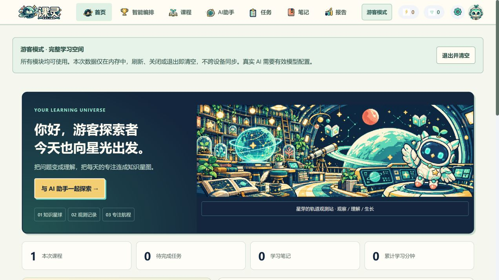
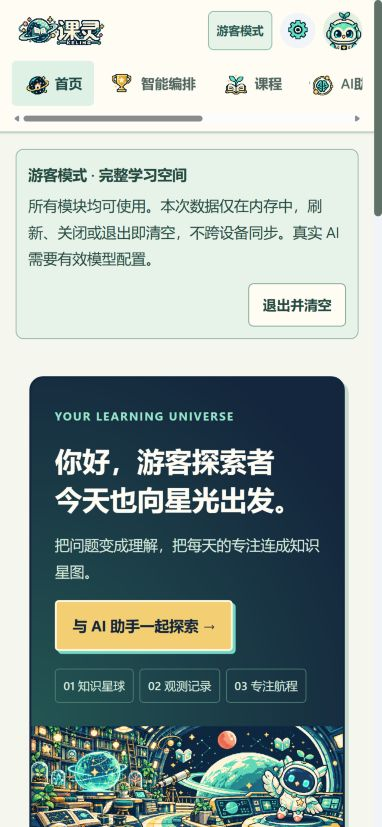
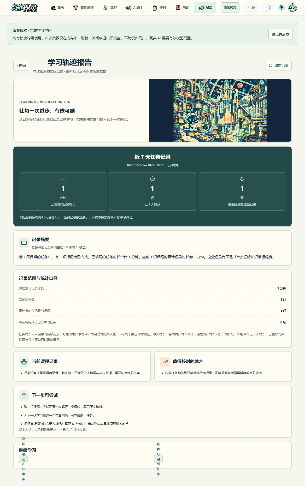

<div align="center">
  

  <h1>课灵 · KeLing4.0</h1>
  <p><strong>把课程资料，变成理解、笔记与下一步行动。</strong></p>
  <p>React 网页 × Kotlin Android · 星际像素学习空间 · 完整游客模式</p>

  <p>
    <a href="https://keling-ict-preview.vercel.app/trial"></a>
    <a href="https://github.com/Hyhyhyyy/KeLing4.0/releases/tag/v3.2.4-preview"></a>
    <a href="apps/android"></a>
    <a href="LICENSE"></a>
  </p>

  <p>
    <a href="https://keling-ict-preview.vercel.app/trial"><strong>立即游客试用 ↗</strong></a>
    &nbsp; · &nbsp;
    <a href="https://github.com/Hyhyhyyy/KeLing4.0/releases/tag/v3.2.4-preview"><strong>下载 Android 预览包</strong></a>
    &nbsp; · &nbsp;
    <a href="docs/PRODUCT_INTRODUCTION.md"><strong>阅读产品介绍</strong></a>
  </p>
</div>

> **版本说明：** KeLing4.0 是本仓库与项目名称，当前可运行版本为 **3.2.4-preview**，Android versionCode **14**。预览 APK 使用调试签名，最低 Android 8.0；不是 4.0 编译版本或应用商店正式包。

课灵围绕一次真实学习组织功能：整理资料，带着依据提问，保存自己的理解，再把计划落实为任务。AI 不替你确认完成，也不会在回答后自动修改学习数据。无需注册即可进入当前端的完整功能界面；需要长期保存和跨端接续时，再使用共享账号。

<p align="center">
  <a href="https://keling-ict-preview.vercel.app/trial">
    
  </a>
  <br />
  <sub>实际 Web 工作台截图 · 游客使用正式主界面与导航</sub>
</p>

<details>
<summary><strong>查看手机浏览器适配与学习报告</strong></summary>
<br />
<table>
  <tr>
    <td align="center" width="32%"><br /><sub>手机浏览器适配；不是 Android 真机截图</sub></td>
    <td align="center" width="68%"><br /><sub>本次任务操作形成的统计，非模型生成的学习效果</sub></td>
  </tr>
</table>
</details>

## 从资料到行动

**整理课程 → 预览资料 → 明确发送 AI 问题 → 核对回答 → 保存笔记 → 确认计划 → 专注与复盘**

| 模块 | 可以做什么 | 设计中的约束 |
| --- | --- | --- |
| 课程与知识 | 整理课程、知识点和关联，准备带资料的问题 | 预览实际摘录；资料变化后重新确认 |
| AI 学习会话 | 概念讲解、练习、复习、追问、切换会话、停止生成、保存回答 | 保留引用快照与服务报告用量；没有配置时不伪造回答 |
| 智能编排 | 根据目标、日期、可用时间与资料生成学习计划 | 校验来源、日期与每日时长；确认后才创建任务 |
| 任务与专注 | 执行任务、暂停／继续计时、确认完成、更新记录 | 预计时长与实际分钟分开；重复完成不重复奖励 |
| 笔记与报告 | 整理理解、编辑笔记、查看学习记录与统计 | 版本冲突保留草稿；统计不冒充 AI 能力测评 |
| 个人空间 | 签到、成就、头像、模型配置及视觉资源 | 记录来源可追溯；尚未接入的设置不作为可用能力展示 |

### 同一学习空间，按端适配

| | Web · 适合集中整理 | Kotlin Android · 适合随身执行 |
| --- | --- | --- |
| 界面 | 宽屏分栏、课程图谱、笔记编辑和报告 | 原生 Compose、触屏卡片、底部导航 |
| 资料 | 课程与知识点编辑、图谱关联，MD／TXT 笔记导入和导出 | 主工作区创建课程、添加资料、编辑笔记；保留本机田园功能入口 |
| AI | 会话、资料预览、模型选择、笔记保存、对话导出 | 会话、资料预览、模型选择、笔记保存与前台状态更新 |
| 学习执行 | 手动任务管理、专注计时和统计 | 计划任务、暂停／继续、实际分钟确认和屏幕唤醒 |
| 数据接续 | 账号已提交数据经共享服务保存 | 同后端、同账号读取共享数据；设备内计时不自动跨端同步 |

两端功能按现有入口实现，并非每项完全相同。例如 Web 的图谱画布和文件导入／导出不能直接算作 Android 云工作区功能；Android 保留的本机田园空间与主工作区也未自动双向合并。详细范围见 [Web 清单](docs/WEB_FEATURE_INVENTORY_2026-10-30.md) 与 [Android 清单](docs/ANDROID_FEATURE_INVENTORY_2026-10-30.md)。

视觉资源共 **44 张共享 PNG**，其中 **29 张为完整场景及入口原画**，其余包含标题、角色、头像、图标和功能图集；不是 44 张独立模块场景。两端共享星芽角色、星球标识与配色，按屏幕调整布局。原画由 AI 辅助生成，[提示词与来源](assets/stellar/prompts.json)随项目保留。

## 不登录，也能完整使用

游客模式复用正式应用的已实现模块，不限制为几个示例卡片。“完整”指入口和功能不因未登录被锁定，不表示原应用尚未实现的功能已经完成。

| | 完整游客 | 登录账号 |
| --- | --- | --- |
| 功能入口 | 当前端正式界面与已实现功能 | 同一套正式界面与已实现功能 |
| 本次跨模块操作 | 保留课程、任务、笔记、会话与模型配置 | 保留并通过共享服务提交学习数据 |
| 下次打开 | 不恢复上次游客内容 | 读取账号已保存内容 |
| 多端同步 | 不参与 | 相同后端、相同账号共享已提交数据 |
| AI 使用 | 有效个人 Key，或明确开启的公共试用模型 | 已配置的账号模型服务，或个人 Key 入口 |
| 转入账号 | 不自动迁入；结束前可自行导出 | 不读取之前的游客内存 |

**Web：** 站内切换保留；刷新、关闭、退出或清空重开会结束本次空间。**Android：** 切换模块或短暂进入后台、且界面未销毁时保留；退出、Activity 销毁重建（包括旋转重建）或进程结束后清空。游客不能作为资料备份；用户主动导出的文件与系统剪贴板副本不会被应用自动删除。

实现说明：[Web 完整游客](docs/TRIAL_WEB.md) · [Android 完整游客](docs/ANDROID_FULL_GUEST_2026-10-30.md)。

## 用自己的 Key 连接 AI

在 **设置、AI 助手或智能编排** 中打开 API Key 模块：

1. 输入 Key，确认它所属的厂商和官方地域。前缀检测只提供候选，不代表认证成功。
2. 点击 **验证并获取模型**，读取该服务返回的实时目录；不支持目录时，可手填已开通的模型 ID。
3. 选择聊天模型，核对资料与发送范围，再明确发送。需要语义检索时另选向量模型，并确认额外用量。
4. 检查回答与引用，按需保存笔记或确认计划。游客 Key 在本次内存跨模块共用，结束后清除。

预设 **17 家模型服务入口**：DeepSeek、阿里云百炼、Kimi、智谱、硅基流动、火山方舟、腾讯混元、华为云 MaaS、OpenAI、Anthropic、Google Gemini、OpenRouter、百度千帆、MiniMax、xAI、Mistral、Groq。

Key 只发给用户选定的服务，不向多家厂商自动试探；模型列表可见不等于已获调用权限或有可用额度。游客真实请求不带账号认证、不建立云端学习记录，但模型商仍按自身政策处理内容并可能计费。完整会话只发送允许的历史和资料摘录，当前检索范围为最近 **24 个知识点＋12 篇笔记**，最多选择 6 条，不是全库向量数据库。

> **真实模型未实测。** 当前没有有效 Key；各厂商真实连通性、目录权限、回答质量、向量效果、计费与 AgentArts 运行尚未完成实测。自动测试使用明确的合成响应，不把它当作真实模型效果。

## 技术与目录

```text
KeLing4.0/
├── apps/
│   ├── web/          React + TypeScript + Vite
│   ├── android/      Kotlin + Jetpack Compose
│   └── server/       Express + Prisma · 共享 API / 模型适配
├── packages/shared/ 共享类型与契约
├── assets/stellar/  星际像素原图、资源清单与生成来源
├── scripts/         本地初始化、测试、构建与资源检查
├── docs/            产品说明、设计、接口与验证证据
└── releases/        交付说明与离线产品介绍
```

账号路径通过共享 API 管理学习数据；Web 游客使用浏览器内存，Android 游客使用独立内存工作区与 `MemoryPreferences`。游客 AI 经无状态接口转发指定内容，会话、计划和任务留在本次内存。现有预览部署在 **Vercel + Neon**；本地开发使用隔离配置，不需要先连接云数据库。

华为云 MaaS 是可选模型入口，AgentArts 保留账号编排适配路径。项目面向 **2026—2027 届华为 ICT 大赛创新赛**准备，但尚不宣称完整参赛合规；Kotlin Android 也不等于原生 HarmonyOS。见[竞赛依据与边界](docs/competition/huawei-ict-2026-2027.md)。

## 本地启动

需要 **Node.js ≥ 22.13**；Android 开发使用 **JDK 17、SDK 34**。

```sh
git clone https://github.com/Hyhyhyyy/KeLing4.0.git
cd KeLing4.0
npm ci --ignore-scripts
npm run setup:local
npm run dev
```

打开 [localhost:5173](http://localhost:5173)。初始化会生成本地配置和随机 JWT 密钥，保留已有数据库；没有模型配置时，日常学习功能可用，AI 显示配置提示。不要把 `.env`、Key 或令牌提交到仓库。

Android：在 Android Studio 打开 `apps/android`。默认 debug API 为模拟器地址 `http://10.0.2.2:3001/api`；真机地址、签名和云端配置见[部署说明](docs/DEPLOYMENT.md)与[发布说明](docs/RELEASE_GUIDE.md)。

### 验证

```sh
npm test
node --test scripts/test-guest-data.cjs
node --test scripts/test-guest-ai.cjs
node --test scripts/guest-workspace.test.cjs
npm run check
node scripts/verify-stellar-assets.cjs
```

Windows Android：

```powershell
./scripts/android-check.ps1 -Lint
```

| 3.2.4 验证对象 | 结果 | 证据边界 |
| --- | --- | --- |
| 服务端 | 完整套件 **48 / 48**；发布发现检查 **2 / 2** | 后者含新增预发布选择用例，与完整套件有重叠；合成响应不代表真实厂商验证 |
| Web 游客 | **24 / 24** 测试通过 | 数据 10、整合 6、AI 8；覆盖隔离、版本、幂等、取消与迟到响应 |
| Android | **52 / 52** JVM 测试通过 | 构建成功；没有真机交互验收 |
| 静态检查 | Web **0 错误 / 36 警告**；Android **0 错误 / 97 警告** | 保留警告，不称零问题 |
| 页面操作 | Web 完整游客工作流与 390px 窄屏已检查 | 没有用浏览器检查替代 Android 真机或跨设备演示 |
| 发布资源 | APK v2 签名通过；44 张共享 PNG 逐项一致 | 调试签名预览包，不是商店正式签名 |

测试日期为 **2026-10-30**。构建、截图、部署与限制分别记录在[完整游客交付记录](docs/FULL_GUEST_2026-10-30.md)及[Android 验证记录](docs/ANDROID_FULL_GUEST_2026-10-30.md)。

## 文档与来源

- [产品介绍](docs/PRODUCT_INTRODUCTION.md) · [离线 HTML](releases/课灵产品介绍.html)
- [总设计大纲](docs/MASTER_DESIGN.md) · [资料引用与版本契约](docs/AI_CONTEXT_CONTRACT.md)
- [Vercel 部署说明](docs/VERCEL_DEPLOYMENT.md) · [模型配置模板](apps/server/.env.ai.example)
- [Web 功能清单](docs/WEB_FEATURE_INVENTORY_2026-10-30.md) · [Android 功能清单](docs/ANDROID_FEATURE_INVENTORY_2026-10-30.md)

本项目在 [CurryHeng/KeLing_ICT](https://github.com/CurryHeng/KeLing_ICT) 的基础上继续开发，感谢原项目提供的课程学习应用基础。当前仓库由 [Hyhyhyyy](https://github.com/Hyhyhyyy) 维护，保留原项目来源及演进记录。

代码按 [MIT License](LICENSE) 提供。Android 内置 Noto Serif SC 字体另遵循 [SIL Open Font License 1.1](apps/android/app/src/main/assets/licenses/noto-serif-sc/OFL.txt)，[来源说明](apps/android/app/src/main/assets/licenses/noto-serif-sc/SOURCE.md)随包保留。视觉与开发使用了 AI 辅助工具；生成来源随仓库保留，参赛或正式发布时应按适用规则披露并核查。
