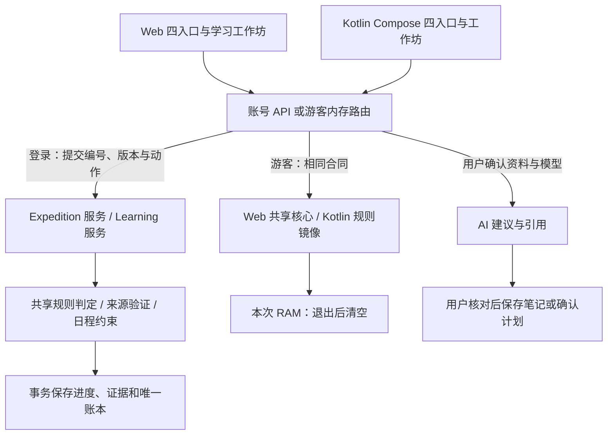

# 课灵 4.0.0-preview 游戏化升级交付记录

更新日期：2026-10-30。源码项目为 `Hyhyhyyy/KeLing4.0`，主开发目录为 `KeLing_ICT`。Android 保持 Kotlin，构建版本为 `4.0.0-preview`、`versionCode 16`。本记录区分已实现功能、已有测试证据和外部验收，不把计划或原画当作运行结果。

## 部署与发布状态

| 对象 | 当前记录 |
| --- | --- |
| 本地源码与构建 | 已完成本节以下所列实现和检查 |
| Web 现有入口 | [完整游客入口](https://keling-ict-preview.vercel.app/trial)；已切换到本版，Vercel CLI inspect 确认 Ready 与正式别名 |
| 正式 Neon 数据库 | 已成功应用 `20261030010000_expedition`；迁移前已建立快照，见下文 |
| GitHub 4.0 发布页 | [v4.0.0-preview](https://github.com/Hyhyhyyy/KeLing4.0/releases/tag/v4.0.0-preview) 为本次目标地址，发布状态待主任务确认 |
| Android Release 附件 | 目标名称 `KeLing-ICT-4.0.0-cloud-debug.apk`；已构建，复制、上传与下载回读状态待主任务确认 |
| 源码提交、标签、CI | 本记录不推测提交号或运行状态，由主任务在发布后补充 |

正式库迁移前快照为 `snap-odd-hall-ao34imc9`，名称 `before-keling-4.0.0-20261030`，保留至 **2026-11-06 06:00 UTC**。这记录已执行的备份点，不代表已经完成生产恢复演练。

Vercel 部署 `dpl_5Jb4hHPUjQsXbEaz7Tu2qjGFYWpC` 已 Ready，别名为 `keling-ict-preview.vercel.app`。验证使用部署元数据，尚未完成本版浏览器操作验收。用户取消的周期性迭代任务不恢复。

## 功能与实际完成范围

本次把资料管理、学习挑战、反馈、下一步安排和个人记录接到四个主入口。原课程、笔记、任务、报告、AI 助手、智能编排、模型配置、头像及 Android 本机田园功能继续可达。

| 入口 / 工作流 | Web 与 Android 已实现能力 | 适用边界 |
| --- | --- | --- |
| 远航 | 课程选择；10 / 20 / 25 分钟建议对应单目标、解释和综合练习；继续既有远征；暂停、恢复和结束 | 时间选择是内容建议；会话时钟不是实际学习时长 |
| 首章挑战 | 二叉树三个目标、18 道原创种子；路线修复和教星芽两种模板；PUSH / POP、直接顺序表单、越界节点选择、解释与逐项自核 | 只交付这个首章，不能声称全学科自动关卡已经完成 |
| 反馈与回访 | 程序规则给出偏差、记录提示和作答；确认反馈并填写下一步；24 小时后回访 | 开放解释为自述；规则通过不等于掌握；生产内容均待独立人工审核 |
| 星图与课程 | 按目标显示状态和来源；保留课程图谱入口；十款独立星球外观在账号中共享 | Web 有图谱画布；Android 主线使用触控列表与卡片，不能把两端控件描述为完全相同 |
| 材料工作坊 | 文字、Markdown、文字 PDF 导入和解析预览；确认保存不可变版本；修订、移除、查看来源；人工确认提取的知识点候选 | 512 KiB、50 页、10 万 UTF-16 字元等输入限制；扫描件无 OCR；候选提取不是 AI 内容审核 |
| AI 辅导 | 明显的 Key 与模型选择；课程、材料和学习过程的预览式问答；回答保存与既有计划能力 | 请求需有效模型配置；合成测试不能代替真实模型；AI 不更改权威证据或钱包 |
| 约束排程 | 开始 / 截止日期、每日预算、时间窗、休息与排除日期；避开课表和已排任务；预览新增项、未分配项、保留项后确认 | 程序硬约束计算，明确区别于 AI 计划建议；不保证所有任务必能排入 |
| 基地与伙伴 | 一个建设位，信号天线、星光档案柜、小型观测台的确定性购买 / 装备；明确保存、修订和删除自己的解释档案 | 装饰无知识加成，不付费解锁阅读；自述不是客观评价或模型永久记忆 |
| 我的 | 证据的题号、版本、来源位置和原作答回看；线下自述、跨端分页历史；历史余额、冲突副本和偏好 | 等级、资源与知识状态分别展示，不据此预测成绩 |
| 完整游客 | 使用当前端相同功能界面；资料、课程、任务、会话、Key、远征和队列跨模块共用本次内存 | 下次打开不恢复，不参与云同步，不自动迁入账号 |

短中长任务、伙伴提示频率、轻量 / 标准叙事和低动效偏好实际影响入口或呈现。偏好在本设备的账号空间保存，游客仅 RAM；没有宣称偏好跨端同步。

新增远航、星图、基地三张独立场景和三张独立透明装饰，资源总数为 **60 张 PNG 视觉资源（含图标与图集）**，包含先前十款知识星球；不声称每张均为独立模块原画。根目录、Web 和 Android 资源逐字节一致。提示词见 [远征资源](../assets/stellar/prompts-expedition.json)和[星球资源](../assets/stellar/prompts-planets.json)。原画是产品美术，不是界面截图；全部 3.2.4 截图只可作为带版本标注的历史证据。

## 从操作到数据的调用链

“操作编号”是一次请求的唯一标识；同一个编号重复发送只返回原结果，不能重复发奖。“写入资格”用于约束同一远征的操作设备，代次变化表明旧设备或旧分支已失效。界面不直接修改奖励，而是提交实际答案、动作和所依据的版本。



| 层次 | 当前代码入口 | 输入、输出和失败处理 |
| --- | --- | --- |
| Web | `pages/Expedition` → `services/expedition.ts`、`expeditionStorage.ts` | 页面提交动作；账号缓存与队列隔离；409 冲突保留原作答与编号 |
| Android | `MainAppContent` → `ExpeditionScreen` → `ExpeditionViewModel` → `ExpeditionTransport` | 登录走 `ExpeditionApi`，游客走 `GuestExpedition`；草稿与待提交操作保持原版本 / 代次 |
| 首章 API | `/api/expedition/v1` → `apps/server/src/expedition/service.ts` | 开始、作答、提示、反馈确认、接管、证据、伙伴档案、自述和基地命令 |
| 权威判定 | `packages/shared/src/expedition/core.ts`、`chapter.json` | 实际输入和内容版本产生反馈、状态及候选奖励；模型没有判定或发奖权限 |
| 资料与日程 | `/api/learning/v1` → `apps/server/src/learning` | 保存不可变版本与片段；生成候选 / 排程预览；资料或工作区变化时拒绝旧确认 |
| 个人 Key 与目录 | 既有模型访问模块、各端 `ModelAccessPanel` | 前缀只给候选，主动向选定服务验证和取目录；不跨厂商试探 Key |
| 游客 AI | `/api/trial/workspace/catalog`、`chat`、`plan` | 无账号学习写入；只转发选定资料与模型参数；结果回到当前内存会话 |

Android 登录草稿按 **API 地址 + 账号 ID** 隔离，原子写入 `noBackupFilesDir/expedition-v1`；该存档不序列化 JWT、模型 Key 或写入 token。Web 使用按账号隔离的 IndexedDB 草稿与待提交队列。旧请求重放得到的是历史收据，客户端还需核对当前进度；不能将旧收据覆盖到更新的投影。过期、被接管或版本改变的操作保留为冲突，用户可保存副本后采用远端，或明确接管。

游客刷新 / 结束之后的迟到结果不能写入新空间。Android 模块切换不会清空；退出、Activity 销毁重建或进程结束会清空，短暂后台不等于立即清除。用户主动导出和剪贴板副本仍由用户保管。详见 [Android 实现与核验](EXPEDITION_ANDROID_2026-10-30.md)。

## 资料、奖励与迁移的可追溯性

资料引用保存版本 ID、片段 ID、内容摘要和 UTF-16 位置；这使修改后的材料不能冒充旧预览。明确选定的课程上下文可包括最多六个知识点、三个材料首片段、三个目标、两条伙伴自述和最近三次远征摘要；用户确认前不静默扩大上传范围。AI 回答标记为建议，开放解释标记为自述。

完成实际作答、阅读反馈并记录下一步，才形成学习循环。循环稳定键防止复制课程或重放请求重复领取；每日循环与结晶有上限，封顶的零额流水也保留。线下自述为独立入口，每日前五次有效记录各 2 XP、无能量 / 结晶，同日相同内容不重复累计时长。基地购买有负结晶流水。旧签到和手动完成不再发放资源；旧成就和历史余额保留，但不能映射为知识证据。

严格独立证据需要已人工审核、未展示的新题、无提示且首次正确；延迟证据还需已有独立证据及到期验证周期。当前十八题人审状态均为 PENDING，因此严格徽章关闭。测试中的 APPROVED 样例只用于检查边界，不进入生产章节。

沿用原账号及课程等主标识，新增资料版本、来源片段、远征、证据操作及奖励账本等表；User 仍是唯一钱包，旧余额快照不是第二份可领取资源。Android 旧 DataStore 只有来源账号匹配、目标为空才复制，原件不删除；归属未知仅作只读概览，不自动上传。迁移、备份及回退步骤见 [数据迁移与回退](design/DATA_MIGRATION_AND_RECOVERY.md)。

## 测试与构建指标

以下为 2026-10-30 的运行结果。各套件检验对象不同，不把测试数量当作学习效果或市场竞争力指标。

| 检验对象 | 结果 | 具体能支持的结论 |
| --- | --- | --- |
| 服务端临时 SQLite 套件 | **68 项通过，0 失败** | 规则、资料版本、权限、唯一奖励、重复操作、写入资格、计划与上下文等受测试约束 |
| Web 新远征 / 学习工作坊 | **25 项通过，0 失败** | 草稿隔离、队列保存、收据合并、游客内存、资料变更及排程确认等路径可重复验证 |
| 原完整游客套件 | **24 项通过，0 失败** | 数据 10、整合 6、AI 8，覆盖旧模块隔离、幂等、取消与迟到响应 |
| Kotlin JVM | **16 个类、78 项通过，0 失败 / 错误** | 同源判定与奖励样例、UTF-8 稳定键、计时、恢复、接管、跨课程新题、自述、资料和迁移边界 |
| 临时 Neon PostgreSQL | **7 组真实事务验证通过** | 迁移、重复提交、并发奖励、设备接管、自述去重、原子消费和 token 不入账本；不等于正式库已升级 |
| 编译 / 静态检查 | Web / 服务端构建成功；Web lint **0 错误、34 警告**；Android 构建成功，lint **0 错误、97 警告** | 保留既有警告，未关闭规则，不称“零问题” |
| 干净环境 | 主任务完成干净依赖安装与构建检查 | 降低依赖仅存在于开发机缓存的风险，不替代所有操作系统验证 |
| 视觉资源 / APK 内容 | 60 PNG 逐字节一致；章节与共享源一致；OFL 和来源说明入包；测试 fixture 未入 APK | 确认打包来源与许可，没有进行新版屏幕视觉验收 |

复现入口：

```sh
npm ci --ignore-scripts
npm run setup:local
npm test
npm run test:expedition --workspace=keling-web
node --test scripts/test-guest-data.cjs
node --test scripts/test-guest-ai.cjs
node --test scripts/guest-workspace.test.cjs
npm run check
node scripts/verify-stellar-assets.cjs
```

Android 使用 JDK 17 / SDK 34；Windows 可运行 `./scripts/android-check.ps1 -Lint`。本次实际 Gradle 任务为 `testDebugUnitTest assembleDebug lintDebug --max-workers=2 --no-daemon`，完成后正常执行 `--stop`。服务端套件使用独立临时 SQLite，清除继承的模型配置，不修改应用数据库。

本机日志包括 `.cache/expedition-server-test.log`、`.cache/web-expedition-test.log`、`.cache/web-expedition-lint.log`、`.cache/web-expedition-build.log`、`.cache/android-expedition-full.log`。Android 机器摘要为 `.cache/android-expedition-validation.json`，另有 `app/build/test-results`、lint 报告和 APK metadata。缓存日志是可再生本机证据，不是应用运行依赖，也不包含对生产迁移成功的推断。

## Android 构建摘要

| 字段 | 已核验值 |
| --- | --- |
| 应用 ID | `com.keling.app` |
| 版本 | `4.0.0-preview` / code `16` |
| 构建输出 | `apps/android/app/build/outputs/apk/debug/app-debug.apk` |
| 目标发布名 | `KeLing-ICT-4.0.0-cloud-debug.apk` |
| 文件长度 | **175,504,993 字节** |
| SHA-256 | `78892c1caf8eaca3027c95fc1234d39146ea52ca2bbf770e1e6d64a5baa8e892` |
| 签名 | APK Signature Scheme v2 验证通过，Android Debug 证书 |
| 证书 SHA-256 | `e7b4d86c7a02fb6bb1d21215c393b347d2d67652e5e45dfbe3a3d6c66b7c67a3` |
| API 地址 | `https://keling-ict-preview.vercel.app/api`，已检查 DEX 中的构建值 |

同版本下载以 [GitHub Release](https://github.com/Hyhyhyyy/KeLing4.0/releases/tag/v4.0.0-preview) 为目标；当前是否已上传见本文件“部署与发布状态”。调试签名并非应用商店正式签名；跨签名安装、从真实旧数据升级及实际启动仍须设备验收。

## 尚需外部验收的边界

1. **公网发布。** 正式库备份与增量迁移已完成，Vercel Ready 与正式别名已确认；线上 API 手工验收、GitHub Release 及附件回读状态需按上表核对。临时 PostgreSQL 分支结果不能替代上线核对。
2. **新版真实界面。** Computer Use 曾因不能可靠确认 Windows 浏览器 URL 被停止，没有绕过限制。4.0 浏览器操作、320 / 390px、200% 字号、键盘导航、低动效实际画面和连续工作流仍待验收。3.2.4 截图只作历史基线。
3. **Android 与双设备。** 没有手机 / 模拟器交互验收证据；安装升级、横竖屏、键盘遮挡、后台与进程销毁、旧资料回退、真实两端接管和恢复仍需实际设备。JVM 与事务测试不能替代录像或真机操作。
4. **真实 AI 与华为联调。** 用户暂无有效 Key，已授权按“未实测”交付；真实厂商目录与权限、回答质量、引用支持、向量效果、费用和 AgentArts 运行未完成验收。当前部署为 Vercel / Neon，MaaS 为可选入口；Kotlin Android 不等于原生 HarmonyOS。
5. **内容与学习效果。** 首章需独立人工复核后才可评估开放严格徽章；尚无学生对照研究或长期使用证据，不能声称提高成绩、诊断能力或优于所有竞品。任意资料自动生成已审核关卡、全学科覆盖、多人社交和原生 HarmonyOS 属于后续范围。
6. **赛事材料。** 已提供模板及必读文档按原文记录；适用附件 3 赛题 / 答疑、队伍资格与实际平台规则仍需核对。报名签章、学校流程、最新版真实画面包与最终演示录制不能由软件测试代替，也不伪造。见[提交要求提取](design/SUBMISSION_REQUIREMENTS_2026-10-30.md)。
7. **正式运营。** 本版是预览交付，未完成应用商店签名发布、长期运维 / 大规模并发、生产恢复演练及不同厂商设备覆盖测试。未测性能不作量化承诺，已有静态警告不隐去。

产品用途说明见 [产品介绍](PRODUCT_INTRODUCTION.md)，本记录用于说明实现与验证证据。用户的原总设计存于 `docs/design/source`，原件保持不变；没有启用定时迭代。
