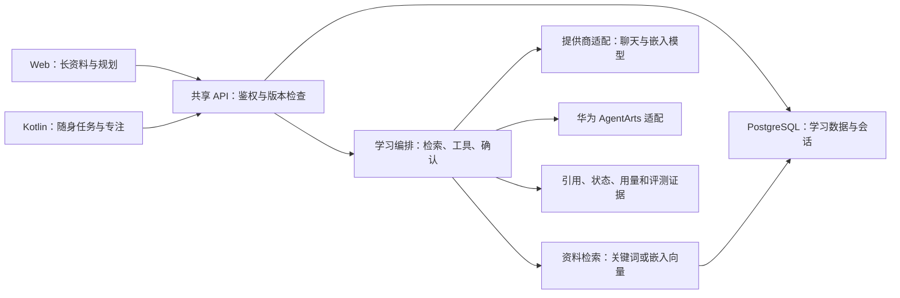

# 课灵：多端 AI 学习系统总设计

2026-10-31：4.0.4 注册登录与分发直连交付见[当前交付记录](auth/DIRECT_ACCESS_2026-10-31.md)。本次为用户明确要求的有限修复，不恢复任何周期任务。

2026-10-30 用户追加的 3.2.4 完整游客补丁已按独立授权实施，两端复用正式功能，数据仅在本次内存。当前实现与验收见 [完整游客记录](history/2026-10/FULL_GUEST_2026-10-30.md)；这不恢复任何周期计划。

版本：2026-10-30，有限交付归档。工作仓库 `C:\Users\lenovo\Documents\ChatGPT\KeLing_ICT`。本文件保留设计依据、实际交付与验证边界，与 [交付状态及历史归档](ITERATION_BACKLOG.md)共同阅读。用户已取消每小时迭代及相关计划；未完成扩展均为归档设想，不构成活跃研发安排。

## 1. 要解决的具体问题

面向需要把课程资料转化为实际学习行动的学生。现有困难是：资料分散、向 AI 问完后难以沉淀、计划与执行脱节、换设备后进度断开。产品的最小完整价值链为：**导入真实资料 → 带依据地解释与练习 → 用户确认计划 → 执行与计时 → 保存理解与复盘 → 调整下一次学习**。

“全局 AI”指 AI 在这条链中理解当前任务并提供适当帮助；不能用每个页面都放一个聊天入口代替。模型不可用时，课程、笔记、任务等基础操作不应被模型配置阻断；账号数据仍需要联网，网络失败不能被描述为已云端保存。免登录试用的本地内存操作与真实模型请求分开。AI 输出是待核实建议，重要写入由用户确认。

## 2. 事实基线与边界

- 已有 Web、Kotlin Android、Express API、Prisma 数据层；Vercel + Neon 公网部署已建立。账户、课程、任务、笔记、头像及 AI 会话使用共享 API。
- 已有聊天/嵌入模型目录、关键词/向量检索选项、引用、会话状态、取消、幂等请求、笔记版本冲突检查、华为 AgentArts 适配路径。代码存在不等于线上能力全部验收。
- 本次已完成两端课程、已保存笔记和任务的上下文预览、可编辑问题与明确发送入口；资料版本变化时保留问题并要求重新预览。两端还提供与账号存储隔离的免登录内存试用、17 厂商临时用户 Key 配置和实时模型目录。
- 用户当前没有可用 Key，已明确接受“真实模型未实测”的交付边界。真实聊天、嵌入检索效果、各厂商实际可用性及 AgentArts 运行未取得本次实测证据。历史单次 DeepSeek 验证见 `competition/deepseek-verification.md`，不能代替当前部署和全模型验证。
- Kotlin Android 不等于原生 HarmonyOS。保留 Kotlin 主线；华为设备兼容性、HMS、原生 HarmonyOS 或硬件扩展各自建立验收证据后再宣称支持。
- 本次服务端 44 / 44、Android 46 / 46 测试通过；Web 构建通过，ESLint 0 错误 / 38 警告；Android APK 构建通过，lint 0 错误 / 96 警告。浏览器已检查试用闭环及 390 像素窄屏，Android 真机、完整无障碍、实际学习效果仍未实测。历史轮次数字保留在对应记录，不冒充本次结果。
- 本轮新增 24 张独立原画，当前共享资源共 44 张 PNG，其中 29 张为完整场景及入口原画；资源清单与 APK 内图片逐项一致。完整视觉或编译通过均不等于模型、性能或设备验收。
- 用户最新授权创建并发布 `Hyhyhyyy/KeLing4.0`，覆盖此前暂不推送的要求；原上游仓库不修改。发布已有 Vercel 预览项目和生成本地 APK 已获授权；不购买资源、不更改账号权限、不创建付费模型调用或替用户提交比赛材料。

## 3. 竞赛路线与材料

用户已在 2026-10-29 明确：**2026—2027 届华为 ICT 大赛创新赛**。这是本项目的目标场景。赛区、具体报名赛题、完整评分细则与截止尚未确认；现有 AgentArts 学习编排方向不能据此认定已选题、具备参赛资格或全面符合比赛要求。规则核验记录见 `competition/huawei-ict-2026-2027.md`。

仓库原有 `competition/liaoning-ict-requirements.md` 及省赛附件保留为历史证据，不再作为本轮华为官网赛事的强制要求。省赛的人数、提交视频时长、模板、截止和晋级条件不能套用至本届官网赛；若用户另行参加省赛，再独立恢复其验收清单。

本次保留需求说明、技术设计、源码、运行说明、产品介绍与已有验证证据。最终参赛模板、演示时长和提交清单尚未形成全面合规结论，必须以本届适用官方规则为准。真实 AI 调用、华为编排运行和真机跨端执行的证据缺口已登记为归档边界，不以本地画面和适配器代替。现有材料区分已验证功能与未实测能力，不承诺获奖与晋级。

## 4. 产品功能地图

|模块|设计中的基本能力|原 AI 深度介入设想|设计判断依据|
|---|---|---|---|
|首页|真实待办、签到、课程与笔记入口|根据当前学习状态推荐下一步，并说明依据|推荐可关闭；无数据时明确引导；不编造学习统计|
|课程/知识星球|资料与知识点整理、关联课程|从资料提取概念和关系，提出缺失知识点|保留来源位置；人工确认后写入；可编辑/撤销|
|AI 助手|模型选择、会话同步、引用、保存笔记|当前课程/笔记/任务上下文、追问、逐题诊断|发送前可见资料范围；不自动发送整库；错误可恢复|
|智能编排|目标、资料、计划预览、任务确认|受时间和资料约束的计划，结合完成记录调整|任务可追溯；确认只执行一次；旧计划不会静默覆盖|
|任务/专注|创建、计时、完成记录、多端同步|解释当前任务、提供提示、完成后复盘|计时与 AI 无关；切换/离线边界明确；防重复奖励|
|笔记|导入、编辑、导出、版本冲突处理|针对当前草稿摘要、质疑、例题和复习卡|建议与原文分开；不会覆盖未保存草稿；引用保留|
|学习报告|真实时间、任务、知识记录|基于证据的薄弱点假设和下一步建议|区分统计与推断；显示采样范围与缺失数据|
|身份/设置|头像、会话、隐私与端设置|控制记忆、上下文范围、模型偏好|可退出/清除局部记录；管理员密钥仅服务端，用户临时 Key 仅当前界面内存|

本表保留原产品设计价值，不是已交付清单；未实现部分均为无执行安排的归档设想。实际交付状态以第 9 节及交付台账为准。特别是未保存草稿的 AI、自动掌握度判断、全功能离线和智能复习，不能因本表列出就宣称已实现。

## 5. 端—云—智架构

主要入口：Web `src/pages/AI/StellarAssistant.tsx`、`pages/Agent/Agent.tsx`、`pages/Notes/SharedNotebook.tsx`；Android `StellarAssistantScreen.kt`、`CloudAgentScreen.kt`、`CloudWorkspaceScreen.kt`；服务端 `apps/server/src`；共享资源 `assets/stellar`。

### 账号 AI 的调用设计与实现边界

以下说明账号功能的调用链和设计约束；其端到端真实模型效果未实测，不把每一项架构目标都当作已完成验收。

1. 客户端收集用户问题、场景和明确选定的资料范围；提供预览和编辑，默认不自动调用模型。
2. API 校验账户归属、长度、模型可用性及配额。聊天模型生成语言；嵌入模型把资料转换为可比较的数字向量，二者独立配置和验证。
3. 检索限定当前用户授权的数据。关键词与向量配置路径已存在，真实向量效果与混合检索比较属于未实测范围；没有证据不捏造引用。
4. 编排层把外部资料当作内容，不能让资料内指令修改权限或调用任意工具。工具采用限定输入、账户隔离与结果校验。
5. 返回答案、引用片段、模型标识、真实用量与状态。用户可保存笔记或确认任务；生成文本本身不直接执行重要写入。
6. 账号任务和会话记录通过共享服务处理；重复请求、取消、超时与版本冲突按各接口约束返回。自动测试覆盖不等于真实断网、设备并发或长期运行全面通过。Vercel 函数存在时限，独立长任务队列仍是归档设想，不能把后台 Promise 视为无限执行。

### 免登录试用与临时用户 Key

试用在两端各自的页面内存管理课程示例、笔记、任务和计时，不调用账号存储，不跨设备同步。退出、网页刷新、Android 页面销毁或进程结束等情况清空本次内容；固定示例明确标注非模型生成。用户可以明确保存回答为本次笔记，或编辑并确认任务，系统不自动代写。

临时 Key 配置提供 17 厂商目录、格式候选提示、实时模型获取、能力区分和手填模型 ID。格式候选不能确认 Key 有效，只有用户点击验证或发送后才向选定服务请求，不向多家试探。Key、连接配置与临时对话不持久化；关闭临时界面清除。用户所选服务商可能处理、保留内容并计费，界面在真实发送前说明；取消等待不保证撤回已经送达厂商的请求。

临时入口单次问题上限 4000 字符，资料最多 3 条、每条正文 2000 字符、标题 120 字符。账号上下文按单篇笔记 6000 字符、单门课程最近更新的最多 6 个知识点且每点 1000 字符、单项任务描述 4000 字符取样，并显示截断与版本。完整字段与失败处理见 `AI_CONTEXT_CONTRACT.md`。

### 可靠性与资源约束

配额、节流、超时、取消、失败恢复和敏感信息处理是现有架构的约束，具体已测范围见接口测试与最终交付记录。真实服务费用、首字及总延时、引用正确性和长期滥用边界未形成完整测量，本次保留为证据缺口；不以提供商数量代表质量，也不自动启动补测。

管理员密钥不向前端暴露，不在 `VITE_*` 中存储机密，不将 `.env`、测试账户数据或鉴权头提交至 Git。用户主动输入的临时 Key 仅在当前界面及本次服务请求中使用，不写入课灵应用数据存储；这不保证网络基础设施或模型商没有运行日志。免费 Vercel / Neon 的使用受平台额度及用途约束，本次不是商业规模容量与成本验证。

## 6. 多端协作契约

共享内容：账号、资料、课程、任务、笔记版本、会话、引用、头像及完成记录。API 字段与错误语义保持一致；变更先定义迁移与向后兼容，再分别实现两端。

Web 侧重并排查看、长文本整理、模型与计划比较；手机侧重拇指可达的入口、暂停计时、快速记录与回顾。设备的未提交草稿、动画偏好、临时计时等状态不得冒充已经云同步。完整离线写入属于归档设想，需要持久队列、版本号、冲突界面与重试策略，当前不能仅靠本地缓存声明离线同步。

本次双线协作采用明确文件所有权、共享 API 契约协调、Web 与 Android 分别验证及集成回归。记录分别说明两端结果，不用一端模拟另一端通过。这是已执行协作方法的记录，不是继续分配研发任务的安排。

## 7. 视觉和交互系统

统一星际像素语言：薄荷绿、海军蓝、奶油白、珊瑚色、金色；星芽保持同一角色特征。场景用完整观测站、实验舱、档案室、生态舱与专注室填充模块，文字和真实控件留在高对比表面。

- 桌面使用分栏和中景，手机使用短幅裁切和垂直卡片；保留焦点角色和有效操作，不能机械缩小桌面。
- 动态分级：点击/悬停反馈、短入场动画、真实加载进度、完成事件庆祝。常驻动画需可关闭，遵循减少动态效果系统偏好；不制造虚假生成进度。
- 输入有标签、字数/范围约束和恢复路径；空状态解释下一步；错误保留草稿；删除和覆盖显示影响范围。
- 键盘焦点清晰、触控目标足够、正常文字对比度以 WCAG AA 为设计目标；图形不能代替按钮语义。动画、对比度、读屏和 Android 真机的完整验收尚未完成，不宣称全面无障碍合规。
- 原图集中存储、提示词可追溯、两端资源 hash 一致。本轮新增 24 张独立原画，共 44 张 PNG、29 张完整场景及入口原画。保留源 PNG；WebP / AVIF 与分辨率档位属于无执行安排的归档设想。

## 8. 竞争力假设与验证

创新候选是“可追溯学习闭环”：同一资料的解释、计划、执行和复盘形成连续证据，并能跨端接续；华为编排承接实际任务流程。统一像素视觉提供可识别性。上述是产品假设，不能直接称为已证明的创新或市场领先。

竞品只借鉴公开交互和技术思路，不复制素材或私有实现。历史研究与差距见 `RESEARCH_AND_GAPS_2026-10-29.md`，本次产品介绍补充了 Google Gemini Notebook 与 Todoist 的官方能力来源。资料引用、教学引导和 AI 任务拆解已被成熟产品覆盖，不把这些称作课灵独有创新，也不以模型数证明竞争力。

原验证设想是以真实学习任务测量成功率、操作次数、用户解释引用依据的能力和失败恢复结果。此类真实参与者研究、学习收益和跨端连续任务评测尚未实施，现归档保留，不构成已证实效果或下一轮安排，不自造用户反馈。

## 9. 有限交付范围与结果

| 范围 | 本次状态 | 证据与边界 |
| --- | --- | --- |
| I0 完整场景与跨端布局 | 历史交付已归档 | 保留 2026-10-29 的视觉、Android 和报告真实性记录。 |
| I1 课程、笔记、任务上下文 | 两端入口、预览、可编辑问题与版本冲突恢复已完成 | 依据 `AI_CONTEXT_CONTRACT.md`；不自动发送，真实模型效果未实测。 |
| 两端内存试用与临时 Key | 独立内存试用、17 厂商、实时模型目录、用户确认的笔记与任务闭环已完成 | 无 Key 时明确使用固定示例；不把试用和临时问答称作账号同步。 |
| 模块原画与端侧适配 | 新增 24 张独立原画，共 44 PNG、29 张场景及入口原画 | 共享资源与 APK 图片逐项一致；不等于性能或全部设备视觉验收。 |
| 自动测试与构建 | 服务端 44 / 44，Android 46 / 46；Web 和 APK 构建通过 | Web lint 0 错误 / 38 警告，Android lint 0 错误 / 96 警告。 |
| 浏览器与产品交付说明 | 已检查试用闭环、5 分钟计时、刷新清空及 390 像素窄屏；产品介绍已完成 | 见 `FINAL_DELIVERY_2026-10-30.md`、`ANDROID_CONTEXT_I1.md` 和 `PRODUCT_INTRODUCTION.md`。 |

用户已明确接受没有 Key 的情况下按未实测边界交付。真实模型、嵌入效果、AgentArts、Android 真机、完整无障碍、学习效果与市场评测仍没有本次验收证据；本次不宣称全部模型可用、全面竞赛合规或产品市场领先。

原 I2—I6 中的真实 AI 与华为调用评测、可靠性容量研究、智能练习、完整竞赛演示、市场验证及新端扩展均归档为设想，保留设计价值，不再设定阶段顺序、截止或后续执行安排。具体归档项见 `ITERATION_BACKLOG.md`。

## 10. 自动迭代已取消与交付结束

2026-10-30 用户已彻底取消每小时迭代及相关计划。原自动化 `automation` 已删除，主线核对全局 `automation.toml` 数量为 0；不得恢复、另建替代任务或通过旧台账继续周期执行。

本次有限交付完成后结束工作，不再依据本总纲自动检索技能、分析下一轮、分配子任务或继续研发。归档设想仅用于理解设计与限制，新增工作必须来自用户新的明确指令。暂不推送 GitHub，保留当前本地成果、必要历史证据和原始资料。

交付记录继续区分自动测试、浏览器观察与未验证事项。原图、接口目录、固定示例和历史单次调用均不替代当前真实模型、账户同步或硬件证据；上述区分是文档真实性要求，不是持续执行计划。
