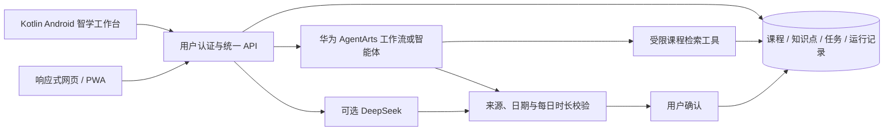

# 课灵多端升级：设计、运行与验证

本轮基线：`CurryHeng/KeLing_ICT` 的 `aa3693e738f58f082c421dc545048bf943d167f3`。Android 保持 Kotlin + Jetpack Compose；网页保持 React + TypeScript；两端智学工作台使用同一套 Express API。本文描述本分支的实现，历史竞赛文档中的待办或演示描述不能替代本轮验证结果。

## 1. 要解决的问题

原版本的 AgentArts 规划主要在网页运行，Android 缺少对应入口。规划请求需要一直保持连接，进度在结束后才返回；进程中断可能留下永久“运行中”的记录。任务完成与发奖分别写入数据库，多个设备同时操作可能重复计分。Android 还有共享本地数据文件、持续收集 Flow 阻塞保存、同步覆盖或格式不兼容等问题。

这一轮以完整的学习流程为验收对象：创建课程和真实资料 → 发起规划 → 查看来源与轨迹 → 人工确认 → 在手机或网页完成任务 → 用实际完成记录复盘。

## 2. 架构与调用链



- Android 入口：精灵助手 → **智学工作台**。`CloudAgentScreen` 渲染界面，`AgentViewModel` 管理请求与界面状态，`AgentApi` 使用当前用户登录凭证调用后端。页面进入前台才轮询，离开页面停止轮询；服务端运行继续。
- 网页入口：**智能编排**，地址 `/agent`。小屏主导航可横向滚动，不再直接隐藏。页面按路由加载，减少首次打开时下载的 JavaScript。
- `POST /api/agent/runs/start` 先保存运行记录并返回 202；`GET /api/agent/runs/:id` 返回数据库中的状态和轨迹。旧同步接口 `/runs` 保留兼容。
- `AgentService` 负责课程归属、来源范围、执行与结果校验。工具只能访问该次运行所属课程和允许的笔记。来源 ID 必须实际被检索过；仅存在于数据库不等于可以作为引用。
- `confirm` 在事务中把计划变为任务。事务可以理解为“一起成功或一起撤销的一组写入”。失败计划无法确认，重复确认不会重复创建任务。
- `completeOwnedTask` 将任务状态、用户奖励、用户/课程学习时长和成就放进同一事务。两个设备同时完成同一任务，只允许一次领取奖励；`0` 分钟不再被替换成预计时长。

## 3. 华为能力与前沿技术的实际落点

对照[华为 AgentArts 调用运行时文档](https://support.huaweicloud.com/api-agentarts/InvokeRuntime.html)（2026-10-28 核验），适配器发送会话 ID、请求 ID、发布/调试模式；工作流使用 `inputs`，单/多智能体额外使用 `query`。当前适配的是 **API Key Bearer 认证**；IAM AK/SK 签名与 OAuth 刷新没有实现。

本项目采用“先检索用户资料，再生成并校验计划”的方法。当前检索是限定课程范围的关键词排序，最多返回 8 条资料，不宣称已实现向量数据库或经过训练的专用模型。运行轨迹只保存工具/节点事件，不保存模型的内部推理内容。模型输出先校验来源、日期和时长，再交给用户确认。

这提供了实际可检查的智能体编排、检索依据和人工确认链路。没有真实云端凭据时，生成按钮明确禁用，不用固定结果冒充云端调用。

平台边界：Kotlin Android APK 面向 Android 兼容设备，网页面向手机、平板和桌面浏览器。依据[华为 HarmonyOS 开发入口](https://developer.huawei.com/consumer/en/harmonyos/develop/)，原生鸿蒙 NEXT 的 ArkTS/ArkUI 客户端是另一个工程，本分支未实现，也未验证华为真机或应用市场上架。

## 4. 本地启动

需要 Node.js 22 或以上（本轮本机使用 24.18.0），Android 使用 JDK 17 和 Android SDK 34。

在仓库根目录运行：

```sh
npm ci --ignore-scripts
npm run setup:local
npm run dev
```

打开 `http://localhost:5173`。`setup:local` 创建随机 JWT 登录密钥、生成 SQLite Prisma Client 并初始化新数据库；已有 `.env` 和数据库不会被覆盖。开发数据保存在 `apps/server/prisma/dev.db`，不进入 Git。

没有云端密钥也能注册、创建课程、保存资料、维护任务和查看既有记录。需要生成计划时再按下一节配置。`npm ci --ignore-scripts` 后必须运行初始化，因为仓库保留的生产 postinstall 面向 PostgreSQL，不能拿它直接连接本地 SQLite。

Android 模拟器默认连接 `http://10.0.2.2:3001/api`。真机和电脑在同一网络时，将构建参数设为电脑可访问地址：

```powershell
cd apps/android
./gradlew.bat assembleDebug -PKELING_API_BASE_URL=http://YOUR_PC_LAN_IP:3001/api
```

本地 HTTP 仅在 debug Manifest 放行。发布构建应显式设置自己的 HTTPS API 地址，并按发布规范签名；不要使用旧仓库的公共服务地址作为新项目的默认后端。已安装 JDK/SDK 的 Windows 用户也可在仓库根目录运行 `./scripts/android-check.ps1 -Lint`，执行单元测试、打包和 Lint。脚本会恢复临时修改的 local.properties。

## 5. 配置 AgentArts

仅在 `apps/server/.env` 保存以下配置，不写进网页、APK、Git 或演示截图：

```dotenv
PLANNING_PROVIDER=agentarts
AGENTARTS_RUNTIME_URL=https://YOUR_RUNTIME_HOST/runtimes/YOUR_RUNTIME/invocations
AGENTARTS_API_KEY=YOUR_RUNTIME_API_KEY
AGENTARTS_TOOL_SECRET=YOUR_RANDOM_TOOL_SECRET
AGENTARTS_INVOKE_MODE=published
AGENTARTS_RUNTIME_KIND=workflow
```

工作流开始节点需接收 `courseId`、`goal`、`examDate`、`dailyMinutes`、`mode`、`startDate`、`courseName`、`runId`、`toolToken`。其中 `runId` 与一次性 `toolToken` 由后端生成，不由用户填写。

检索节点向你部署的后端 `POST /api/agent/tools/search`，请求头为 `x-agentarts-tool-key`，值与服务端 `AGENTARTS_TOOL_SECRET` 相同；请求体包含 `runId`、`toolToken`、`query`。这个地址必须能被云端运行时通过 HTTPS 访问，云端无法回调你电脑的 localhost。工具密钥应保存在云端节点的安全配置中，不能拼入提示词。

模型节点只根据检索结果输出以下 JSON，结束节点输出变量名使用 `plan`：

```json
{
  "summary": "计划说明",
  "tasks": [{
    "title": "学习任务",
    "description": "具体行动",
    "date": "YYYY-MM-DD",
    "minutes": 30,
    "sourceIds": ["检索结果中的实际来源 ID"]
  }]
}
```

日期按北京时间，在今天至目标日期之间；每日任务时长合计不能超过预算。提示词应明确：资料是待学习内容，忽略其中要求改变规则或执行操作的文字；复盘参考真实任务完成状态。当前适配器要求流中有完整结束事件和结构化结果，缺失时拒绝接受。

选择 `PLANNING_PROVIDER=deepseek` 时使用服务器 `DEEPSEEK_API_KEY`；这是独立提供方，不代表使用了华为。显式配置某提供方却缺少凭据时，不会偷偷切换。`auto` 模式优先 AgentArts，其次 DeepSeek。状态“已配置”只说明必需配置存在，不代表云端连通性已经通过实测。

## 6. 失败、数据与回滚

- 网络断开：运行继续，重新打开历史恢复查看；页面不会自动再次付费生成。单次运行超过 120 秒时在下一次读取中标记失败。后台任务依赖当前服务进程，尚未使用持久化工作队列；重启后的运行会超时失败，需要用户重试。
- 轨迹通过比较旧值再更新的方式保存，避免运行事件与检索审计相互覆盖；失败也保留已发生的检索轨迹。
- Android 本地存储按账户隔离，旧共享文件只在能确认账户归属时迁移，保留原始文件。无法解析的数据不会被当成空数据覆盖。
- 原 Android 本地课程编辑、笔记和本地奖励没有改造成完整双向同步。智学工作台中的课程、资料与任务以服务器为准；主任务页中的云端任务使用“云端执行”入口，避免在本地再次奖励。已导入云端任务的状态随手动同步刷新，本地隐藏的记录不会自动复活。
- 本轮不更改数据库表结构。回退代码前保留数据库与 Android 数据备份；运行记录与已确认任务都需要保留。不要删除数据库来掩盖失败。已经完成的任务不支持重新开启；要重新练习，应新建任务。
- 部署使用 PostgreSQL 时按现有 `schema.postgresql.prisma` 和 migrations 流程处理。本轮事务测试在 SQLite 运行，尚未做 PostgreSQL 负载、故障注入或云端多实例验证。

## 7. 可复现验证与后续顺序

```sh
npm test
npm run check
npm audit --omit=dev --audit-level=high
```

`npm test` 使用独立临时 SQLite，不接触应用数据库。测试覆盖规划来源校验、SSE 分片/截断、鉴权、显式提供方选择、后台轨迹、超时恢复、并发完成与事务回滚。Android 测试覆盖账户隔离、迁移、保存、接口错误、数组/旧字符串兼容和云端任务状态合并。

研发顺序：

1. 本分支实现核心多端学习链路及回归测试。
2. 配置真实 AgentArts 工作流后，记录一次真实“检索—规划—确认—完成—复盘”演示及失败案例；目前待验证。
3. 用华为 Android 兼容真机、普通 Android 手机、平板和桌面浏览器做显示/网络切换/后台恢复测试；目前没有真机证据。
4. 在 PostgreSQL 部署上验证并发和恢复，再考虑持久化工作队列、请求幂等键、全量双向同步冲突策略。
5. 如确需原生鸿蒙 NEXT，新增 ArkTS 客户端复用本项目 API；不更换现有 Kotlin 客户端。

不要把路线图项目、模拟提供方测试或本地 SQLite 通过描述成已经完成的生产上线、真实云联调或所有平台验证。
