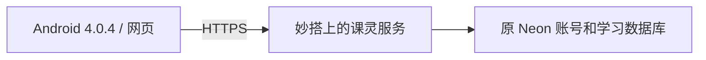

# 4.0.4 注册、登录与安装包直连交付

日期：2026-10-31。此记录接续 4.0.2 的网络阻塞记录；没有购买域名、服务器，也没有迁移账号数据库。

## 当前入口

- 网页：https://ucn5aajxnx7f.feishu.link/app/app_17h4dw5jwdg
- API：同一地址加 `/api`。
- Android：`releases/KeLing-ICT-4.0.4-direct-cloud-debug.apk`，versionCode 20，最低 Android 8.0。
- 安装包直连入口：同一网页地址加 `/download/android`；发布与完整文件校验状态见 `validation-direct.json`。

APK 大小 92,677,090 字节；SHA-256：`06cd24349c38899b3e11bf35911c4034a397b999b4c84a6dcde459ac14c9963b`。

## 原因与处理

原 `*.vercel.app` 入口在本次直连网络下出现 DNS/连接故障。电脑系统代理掩盖了这一问题，因此电脑可用不能证明手机可用。只把等待时间缩短不能恢复注册。

本次使用现有妙搭账号托管完整课灵后端及网页。曾验证转发原 Vercel 的方案，云端到原地址也失败，因此最终后端直接运行在妙搭，连接原 Neon PostgreSQL 数据库。原账号、密码散列和学习数据没有搬迁；原登录签名配置保留在平台环境变量中，不进入源代码。

注册、登录仍调用原 `apps/server/src/controllers/auth.ts`。新平台只承担运行位置与入口：`keling-access-gateway/server/modules/gateway/gateway.service.ts` 将带应用前缀的请求交给原 Express 服务。`scripts/prepare-miaoda.cjs` 生成可追溯的部署副本，`vendor/source-manifest.json` 保存源文件摘要；构建不执行数据库迁移。

网页适配应用前缀和平台的请求校验：浏览器发送的校验标记必须与 Cookie 中相同。已修复根路径和子路径 Cookie 不一致导致刷新后 403 的问题。Android 自动完成这一校验，用户不需要填写连接参数。

Android 默认入口已更换；旧内置地址与新入口明确识别为同一账号服务，真正不同的自定义地址不会复用旧登录凭证。网页和 Android 的注册、登录均有独立的 25 秒等待上限与取消按钮，避免网络层迟迟不返回时界面一直转圈。晚到结果不能覆盖新尝试。停止等待不代表服务器撤销注册，因此超时提示建议先尝试登录。

共享托管入口下，已验证身份的正常请求按账号计数；登录尝试按来源与邮箱计数，并保留来源总量限制。无效登录凭证不能创建独立限流额度，避免多人共用入口时相互占用正常使用额度。

## 已验证的结果

测试对象均为本次创建的随机 `.invalid` 测试账号；没有使用真实用户密码。

- Windows Chrome 明确以 `--no-proxy-server` 启动；Android 14 模拟器代理为 `:0`。
- 直连网页 HTTP 200；数据库就绪检查 HTTP 200。
- 网页实际注册成功并进入学习首页，错误密码 401，正确重试 200，重复注册 409。
- 网页退出、重登及刷新恢复成功；390 px 和 1440 px 视口无横向溢出，未捕获脚本异常。
- 浏览器将登录请求故意挂起，约 24,989 ms 后结束等待；取消等待后可继续提交，恢复请求后登录 200。
- Android 实际注册成功并进入学习页；该账号在网页登录 200。原 Vercel 服务创建的测试账号也已在无代理 Android 中成功登录。
- Android 应用退出进程后重开，登录状态保留。
- 网页创建的账号在 Android 登录成功；Android 错误密码提示后，正确密码重试成功。
- Android 89 项单元测试通过；lint 0 错误、97 条既有警告。网页构建及 lint 通过（34 条既有警告）；认证 7 项测试、共享入口限流 3 项测试通过。
- 后端完整 77 项测试通过，使用隔离临时 SQLite，未修改应用数据库。APK 签名校验通过，证书与本机 4.0.1 预览包一致。

最后发布的提交为 `2227303c9bd148fd3b77434f7a8e4332cb853e03`，发布编号 `7702800561124854787`，平台返回 finished。4.0.4 APK 在该版本服务上实际注册成功，该账号在无代理 Chrome 登录并刷新恢复成功。四个自建测试账号已按随机邮箱、名称、创建时间及密码散列核验后删除；其他账号未修改。

截图位于 `screenshots/direct/`。完整结果记录在 `validation-direct.json`。

## 安装包分发与资源编码

最终下载入口从文件存储生成短期有效地址；每次点击重新生成，入口不会在一小时后失效。匿名无代理下载完整 92,677,090 字节，用时 53.524 秒，SHA-256 与签名验证后的本地包一致。旧的应用服务内转发大文件方案曾在完整下载时截断，已移除；不能用局部下载成功代替完整文件校验。

4.0.4 把 60 张游戏图片从 PNG 改为最高有损质量的 WebP，图片总量由 117,597,106 字节降至 35,640,704 字节，APK 从约 175 MB 降至约 93 MB。原 PNG 保留在 `apps/android/app/src/main/assets/stellar`；发布素材位于 `optimizedAssets/stellar`，Gradle 不再重复打包原 PNG。图片尺寸、透明度全部一致，像素颜色存在编码差异；在白色背景上比较 RGB 数值，最大均方根差为 7.6264/255。旧课程的 26 款 PNG 星球素材仍按原路径打包。

`scripts/prepare-android-art.py` 使用 Pillow 12.3.0 生成素材；`--verify` 校验原图、生成文件的摘要及图像属性。普通 Android 构建直接使用已提交的 WebP，不依赖 Python。逐张记录见 `android-art-manifest.json`。已检查 APK 实际文件内容，并在 Android 14 模拟器重新安装、登录、重启和查看游戏画面。

## 如何复现及边界

打开新网页，注册测试账号，刷新后退出再登录；安装 4.0.4 APK，用同一账号登录，再从手机注册另一账号并在网页登录。无需先购买资源或设置代理。

证据覆盖当前网络下的 Chrome 与 Android 14 模拟器；没有接入用户的实体手机，也不把模拟器结果称为真机验收。APK 仍为调试签名预览包；本次没有宣称正式商店发布、所有地区可达或真实 AI 模型功能已经全面验收。旧域名书签和旧 APK 不会凭空变成新入口，应使用上述地址和新包。
