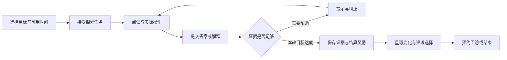

# 课灵游戏化学习最终升级方案

2026 年 10 月 30 日 · 产品设计与实施规划定稿

## 一 产品定位与最终决策

**课灵是一款以星际探索为体验主线、由 AI 辅导和真实课程资料支撑的游戏化学习产品。学生通过学习、尝试、解释、应用和复习建设自己的知识星球，与伙伴共同完成课程远征。**

游戏化贯穿目标选择、学习操作、挑战反馈、长期成长和协作。用户的每一次有意义的学习，都能带来可理解的世界变化；每一项知识成就，都能回到真实的学习证据。

本版确定以下方向：

1. **课程成为可探索的星球，章节成为区域，知识关系成为路线。**地图用于选择和理解学习路径，不只是课程封面。
2. **学习成为有目标、有选择、有反馈的任务。**核心挑战需要运用课程知识，完成任务会改变世界状态。
3. **星芽成为持续陪伴的 AI 学习伙伴。**它负责提示、追问、示范与复盘，成长内容来自学生的真实学习历程。
4. **形成两种清晰的成长。**角色等级和建设资源认可投入；知识徽章依据可回看的作答与验证。两者分别展示。
5. **复习进入探索主线。**回到旧区域能发现新的联系、完成变式挑战；历史成果不会因为几天没登录而消失。
6. **华为思路服务于游戏体验。**意图直达一场远征、卡片呈现当前任务、多端继续同一关卡，AgentArts 承担有依据、可追踪的任务编排。

本文件替代上一份分析稿中将游戏化主要放在辅助反馈层的定位。上一稿中的竞品调查、代码证据、可靠性问题及学习验证原则继续保留；本版重新确定产品结构与实施顺序。这里的“定稿”指本轮设计基线，新增功能仍需开发和验证，不表示已经上线或已证明提分。

## 二 当前基础与必须纠正的问题

### 可继承的资产

当前项目已有星际视觉、星芽、课程与知识节点、任务、笔记、经验、等级、能量、结晶及成就结构。早期[游戏化闭环设计](../../apps/android/docs/AI_GAME_LOOP_DESIGN.md)还规划了复习、社交和商城。这说明游戏化是项目已有方向，应围绕它重新组织产品，而不是另造一套普通效率工具。

本次核对的[数据模型](../../apps/android/app/src/main/java/com/keling/app/data/Models.kt)包含 `Course`、`KnowledgeNode`、`Task`、`Rewards`；[商城模型](../../apps/android/app/src/main/java/com/keling/app/data/Shop.kt)包含 `MASTERY_BOOST` 等效果类型；[复习模块](../../apps/android/app/src/main/java/com/keling/app/data/ReviewEngine.kt)包含复习项和 SM-2 相关字段。**文件或枚举存在，不代表它们已接入当前云端主流程或经过效果验证。**

当前 Android 主入口为 `MobileApp`，相关网页与服务端的较新功能位于相邻 `KeLing_ICT`，两边功能存在分叉。实施前必须核对入口、API 和保存路径，不能依据版本号大小直接覆盖。[现状分析与证据索引](KELING_UPGRADE_DESIGN_2026-10-30.md)

### 游戏化改造的关键问题

| 当前问题 | 本版确定的改变 | 判断依据 |
| --- | --- | --- |
| 星球、插画与实际学习进度联系较弱 | 星球区域由课程知识组织，每个变化对应具体任务或学习证据 | 当前首页和课程卡主要呈现统计、插画及模块入口 |
| 签到、手动完成和分钟数容易成为主要奖励来源 | 奖励围绕有效尝试、纠正、独立应用和延迟验证；单纯停留不发资源 | 当前任务完成接口按完成状态发奖励，没有逐题证据链 |
| 经验、能量、结晶、掌握度容易混淆 | 角色经验与建设结晶保留；学习证据独立；能量不再成为学习门票 | 现有 `User`、`Rewards`、`KnowledgeNode` 使用不同数值但产品解释不足 |
| 历史模型存在“掌握度加成”概念 | 新规则取消道具、付费或经验直接改变知识证据的设计 | `MASTERY_BOOST` 是历史类型定义，本次不宣称它已实际生效 |
| 任务更像附带奖励的待办 | 新增知识操作型关卡、解释型任务和综合任务，有过程反馈与重试路径 | 仅点击完成无法判断学生是否能应用知识 |
| 复习、社交、商城范围过大 | 先完成一个可持续游玩的学习循环，再逐步开放合作与装扮 | 早期蓝图跨度从学期规划到生活、社交、商城，维护范围过大 |
| 云端与本机、当前会话与已存数据边界不清 | 学习、关卡和奖励共享状态；草稿、断网和待结算明确显示 | 当前主工作区计时关闭后不保留，跨端共享不等于关卡接续 |

## 三 竞品与学习研究给出的设计依据

| 参照 | 可核实的借鉴点 | 课灵的适配 |
| --- | --- | --- |
| Duolingo 学习路径 | 2022 年官方改版将新内容、练习和故事放入连续路径，减少用户决定下一步的负担。[官方说明](https://blog.duolingo.com/new-duolingo-home-screen-design/) | 新学习、巩固和剧情在同一课程路线内组织；允许用户选路和诊断跳过，不把所有学科压成单一路径 |
| Duolingo 好友任务 | 官方案例让用户围绕共同目标协作。[好友任务](https://blog.duolingo.com/friends-quests/) | 小队共同修复一座知识设施，每人贡献解释、验证或应用；不照搬历史配对时间、期限和奖励数值 |
| Forest | 将专注过程转化为可积累的树木景观。[官网](https://www.forestapp.cc/) | 学习成果形成可见、可回访的星球建设；专注仅表示投入，不直接表示掌握，不采用离开即毁掉成果的反馈 |
| NotebookLM 对应的 Gemini Notebook | 资料引用、抽认卡、测验与进度延续已有成熟产品实践。[引用](https://support.google.com/gemininotebook/answer/16179559)、[测验](https://support.google.com/gemininotebook/answer/16958963?hl=zh-Hans) | 作为关卡内容和反馈依据；游戏世界必须能回到真实材料 |
| Anki | 复习调度依赖作答历史，目标记忆保持率与复习工作量有关。[官方手册](https://docs.ankiweb.net/manual/deck-options) | 记忆类任务评估采用 FSRS；理解与迁移另用变式和解释验证 |

Sailer 与 Homner 的元分析报告了游戏化对学习结果的平均正向效应，同时发现研究结果存在差异，动机和行为效应在更严格研究子集中的稳定性较弱。这支持尝试有依据的游戏设计，也要求单独验证课灵的效果。论文于 2019 年在线发表、收入 2020 年卷期，不应称作最新研究；它不能证明本方案的某种玩法一定有效。[原始论文](https://link.springer.com/article/10.1007/s10648-019-09498-w)

课灵的差异化假设是：**把学生自己的课程资料组织成可玩的学习任务，让游戏世界记录理解过程，并让同一段探索在多个设备上继续。**资料生成、游戏奖励和 AI 辅导各自都不是独有创新；价值需要通过完整体验、内容质量与长期使用验证。

## 四 世界观和学习行为的对应关系

### 世界设定

学生是一名知识星系的探索者，与星芽一起建立学习基地。每门课程是一颗待探索的星球，课程中的概念连接成区域和航线。学习的目的，是理解这些世界如何运作，并用所学解决其中的问题。

叙事保持轻量、适合大学生。课堂任务、考试和真实资料始终用正常名称标注，例如“数据结构星球 · 二叉树”。故事提供行动情境，不遮蔽实际学科要求。

| 游戏元素 | 对应学习对象 | 用户操作 | 可见变化 |
| --- | --- | --- | --- |
| 课程星球 | 一门课程及其资料 | 导入材料、选择目标、进入章节 | 星球形成章节地图；未识别部分保留待确认状态 |
| 区域与航线 | 章节、概念、经确认的先修关系 | 选路线、查看先修、诊断跳过 | 可探索区域与推荐路线发生变化 |
| 探索任务 | 一次明确学习目标 | 阅读、笔记、解释、练习 | 发现新地点、形成学习档案 |
| 修复挑战 | 一个待解决的概念问题 | 操作知识对象、预测、纠正 | 装置按学科规则恢复运行 |
| 章末试炼 | 综合应用目标 | 组合多个概念解决问题 | 获得有证据的章节徽章与故事进展 |
| 回访远征 | 间隔复习与延迟变式 | 回忆、再次应用、修正解释 | 为已探索区域补充新的验证记录 |
| 基地建筑 | 学习成果的长期陈列与组织 | 选择建设、查看成果、装扮 | 场景持续丰富，点击能回到关联成果 |
| 星芽的能力档案 | 学生讲清过、纠正过的知识 | 教星芽、查看记忆、纠正或删除 | 解锁对应展示动作和知识卡；不暗示模型权重被训练 |

地图上的“未验证”表示缺少学习证据，不表示禁止查看资料。学生可以自由阅读、调整路线；建议先修和徽章条件明确显示。地图同时提供可访问的列表视图，不能只靠颜色、拖拽或空间位置使用。

## 五 四层游戏循环

### 每次操作的反馈

学生做出预测、排列节点或提交解释后，先看到课程规则带来的结果。例如错误的队列操作会生成错误的广播顺序，界面指出首次偏差，并允许逐步回放。反馈不只显示对错或播放庆祝动画。

### 一次 10 至 25 分钟的远征



一次失败不会丢失已完成的学习或已拥有的建筑。系统给出分级提示、示例和下一次尝试；可以暂停、保留进度并退出，不强制立即再来一局。

### 一周的章节推进

新内容探索、旧内容回访和一个综合任务共同组成章节路线。玩家自己选定本周投入，系统把任务安排在真实课表空闲时间内。剧情按照章节成果推进；游戏周期不覆盖真实截止日期，也不为了周活动强行增加学习量。

### 一学期的成长

课程星球逐渐形成完整的探索记录，基地陈列笔记、项目、徽章和代表性解释。课程结课后保留地图与成果，下一学期可以回访、重新验证或迁移相关知识，不清空历史积累。学期目标对应长期方向，角色等级表达累计经历，二者不转换为考试成绩预测。

## 六 核心玩法与功能规格

### 1 资料生成课程地图

输入一份课程材料并设定目标后，系统提出章节、概念与任务候选。用户先确认地图，系统再生成可玩的内容。首版支持文本、Markdown 和可提取文字的 PDF；扫描件、照片和录音后续扩展，不能在解析失败时生成虚构完整地图。

地图节点保存资料版本、页码或段落位置，以及任务目标。先修关系由课程资料和人工核对支撑，AI 推断关系显示“待确认”。地图生成是对资料的可编辑组织，不宣称自动理解所有学科。

### 2 知识操作型挑战

游戏中的操作需要体现真实知识关系：

| 任务模板 | 学习动作 | 首期例子 | 判定方式 |
| --- | --- | --- | --- |
| 路线修复 | 排序、分类、逐步推演 | 调度通信节点，比较队列和栈产生的访问顺序 | 确定规则检查步骤；支持按钮和键盘操作 |
| 误区侦察 | 找出错误假设、给反例 | 检查一个“看似正确”的二叉搜索树解释 | 对照明确条件及已核验答案 |
| 教星芽 | 用自己的话解释并回答追问 | 讲清“左子树都小于根”与“左孩子小于根”的区别 | 明确评分条目；开放回答先作反馈，必要时人工复核 |
| 知识拼装 | 将概念用于新问题 | 为一个小型检索系统选择合适的数据结构 | 关键约束、过程与理由分别评价 |
| 记忆回访 | 闭卷回忆并延迟再测 | 术语、复杂度、性质的短答 | 已核验题与复习调度 |

首个版本只实现“路线修复”和“教星芽”两类模板，以数据结构的一章验证体验。其他学科先用解释、分类、排序和变式这些通用结构，缺少可靠判定器时保持练习反馈状态，不自动颁发严格验证徽章。

游戏操作失败与知识错误分开记录。若学生因触控不准、设备问题或不理解操作方式失败，不据此下调学习判断；提供传统表单或列表替代。

### 3 章节试炼

章节试炼是需要综合运用知识的任务，可在界面中称为 Boss 关，但内容必须对应学科目标。它不是给普通题目加一条怪物血条。

示例：为失联的通信基地设计广播顺序。学生需要解释为什么选队列、执行遍历，并在结构变化后修正方案。判定分别记录规则选择、推演过程和解释；一道题答对不代表整个章节已经掌握。

试炼支持“训练”和“独立验证”两种方式。训练允许随时提示；独立验证如使用提示，保留该轮训练成果，另约一组新变式来取得独立证据。任务难度预先可见，AI 可以建议调整，不在学生不知情时偷偷降低标准。

### 4 星芽伙伴

星芽承担四种具体作用：开始前解释任务；遇到困难时给最小必要提示；完成后追问一个关键条件；隔天回访时带回待验证的问题。它知道哪些内容来自材料、哪些是自己的解释，并允许用户核查和纠正。

伙伴成长包括外观、动作、日志和知识收藏。学生讲清一个概念后，可以把经核对的解释写入“我教会星芽的知识”。这是应用保存的学习档案，不是模型自行获得了永久记忆或真实情感。

用户可以调整伙伴的提示频率和叙事浓度。低动效模式减少动画与对白，仍保留地图、任务选择和成长关系；游戏化主结构不因此消失。

### 5 基地建设与收集

基地作为长期目标，首期提供一处固定建设位和少量确定性装饰，后续开放更多布局。建筑兼具陈列和快捷入口：档案馆展示学生笔记，观测站展示课程关系，通信站回放已经完成的推演任务。

所有基础学习功能始终可访问；未建设档案馆也能正常读写笔记。建设带来展示与个性选择，不以消耗资源解锁提示、读材料或保存作答。

建筑外观可由结晶购买，知识徽章只能由证据取得。一个学生可以因持续努力拥有漂亮基地，同时仍有尚未验证的知识区域；这种区别应直接可见，不用建筑等级替代学习水平。

### 6 复习远征与回归体验

到期复习以回访任务进入航线，旧区域增加新的条件和联系，避免只是重复相同题刷资源。记忆类内容根据复习记录安排，理解类内容用延迟解释与变式题确认。

遗忘时显示“建议回访”，不摧毁建筑、不降低历史荣誉、不把星芽描写为被抛弃。离开数天后提供一个短回归任务和可调整的计划，不一次堆满所有欠账。用户能说明今天只有少量时间，由系统给出缩小范围后的安排。

### 7 真实时间约束的远征计划

今日页提供短、中、长三种任务时长候选，具体时间由任务内容和用户预算确定。任务需要满足课表、考试日期、休息和固定安排，不能为了凑足游戏任务让日程冲突。

时间变化时先展示调整差异：保留哪些任务、顺延哪些回访、哪些目标可能无法覆盖。用户确认后再更新计划；已完成、进行中和锁定任务保持受保护状态。模型解释取舍，程序检验硬约束。

### 8 合作远征

第二阶段引入邀请制小队，建议先试 2–4 人。小队共建一个课程设施，每位成员完成自己的学习任务并选择分享一个成果：解释、反例或经核对的解法。队友通过互相提问产生新的理解，而不仅是把个人经验值相加。

共享贡献按不同目标和有效回访计入；同一题重复提交不增加团队进度。成员退出或缺席不扣全队成果。材料、原始答案和个人薄弱点默认不公开，只分享用户选定的成果与进度摘要。首期使用有限的感谢与反馈动作，开放聊天和公开社区另行评估。

竞争作为自愿活动，仅在相同课程、相近目标及明确规则内比较；优先展示个人进步与共同目标。不同课程之间不按时长、XP 或所谓统一能力分排名。没有真实同伴时保留单人路线，不能用机器人冒充真人队友。

## 七 成长与奖励规则

### 三类信息分别表达

| 信息 | 表示什么 | 可以如何变化 | 不能代表什么 |
| --- | --- | --- | --- |
| 探索经验与角色等级 | 累积的有效参与和成长经历 | 学习事件结算后增加；沿用并审查现有等级规则 | 不能代表知识掌握、智力或成绩 |
| 结晶 | 建设和装扮资源 | 按规则获得、在基地确定性消费 | 不能购买题目正确性、独立验证或学科能力 |
| 知识状态与徽章 | 针对明确目标的证据 | 阅读或尝试后标记探索；独立应用和延迟验证分别记录 | 不能由签到、计时或道具直接改变 |

知识状态采用“待探索 → 已尝试 → 有独立证据 → 有延迟证据”。“建议回访”是附加状态，不删除过去的证据。所谓章节完成必须能说明完成了哪些目标、缺了哪些目标，初期不输出精确掌握百分比。

### 初始奖励参数

以下为可配置的首轮试点参数，用于检验平衡，不是研究得出的最佳数值。

| 事件 | 探索经验 | 结晶 | 结算条件 |
| --- | ---: | ---: | --- |
| 完成一次有效的学习循环 | 10 | 2 | 有实质尝试、查看反馈并形成下一步；同一目标任务周期只发一次 |
| 一个目标首次取得独立验证 | 20 | 4 | 通过对应已核验的新题或明确评分条目；每个目标里程碑一次 |
| 完成一次计划内的延迟验证 | 15 | 3 | 到达允许回访时间，以新变式或重新回忆验证；该复习周期一次 |
| 手动记录线下学习 | 2 | 0 | 标明自述、每日最多 5 次；不自动改变知识状态 |
| 仅签到、挂计时器或反复点完成 | 0 | 0 | 可以记下到访或时间，不单独产生建设资源 |

每个学习日最多 5 次学习循环获得经济奖励，后续仍记录学习与证据；独立里程碑和到期回访按各自去重规则计算。上限不是学习量目标，也不以倒计时催促领取。首轮每日建设结晶总发放上限设为 30，超过部分不形成次日欠账；这一数值应随试点调整。

第一件可自选装饰定价 6 结晶，普通装饰初始区间 6–12，建筑外观升级初始为 30；均显示确定价格与效果。示例中一次首次独立验证连同学习循环可得 30 XP、6 结晶，即可做一次可见建设选择。答错但认真修正仍有学习循环奖励；故意先答错再改对，不会比同等目标直接完成得到更多奖励。

### 一致性与防重复

业务事件由服务端确认。重复请求、两台设备同时提交、退出重进均只能结算一次；同一目标复制成多个任务也不能重复领取首次徽章。去重依据使用稳定的目标、里程碑和复习周期标识，不能只凭客户端随机生成的请求 ID。规则版本只用于追溯，更新规则不能重新发放旧奖励。

在自述、开放解释等任务中，系统无法完全确认用户是否真的完成了线下行为。因此这类奖励保持低额，证据类型显式展示；不通过摄像头监控、强制截屏或过度采集来换取表面的准确。

### 旧数据迁移

保留已有等级、经验和已确认结晶，标注其历史规则；不把历史积分转换为知识徽章。旧能量余额保留在历史荣誉记录中，新主流程停止发放或消耗能量，不设置学习体力门槛。已有物品和原始数据保留，涉及掌握度或学习特权的旧效果不进入新证据计算。

本机与云端数据按账号和来源逐项核对，显示迁移预览；同源记录去重，不能直接把两个余额相加。迁移保存快照和映射，失败可回到旧状态。未经来源确认的本机资料暂留，不能分配给任意新账号。

## 八 页面结构与视觉方向

### 四个主入口

| 入口 | 普通语言说明 | 核心内容 |
| --- | --- | --- |
| 远航 | 今日学习任务 | 当前星球、推荐远征、进行中任务、到期回访、时间调整 |
| 星图 | 课程与资料 | 课程星球、章节地图、来源阅读、笔记、挑战入口 |
| 基地 | 建设与伙伴 | 场景建设、星芽档案、收藏；后续开放小队入口 |
| 我的 | 成长记录与设置 | 证据报告、历史荣誉、账号、导出、模型与通知偏好 |

界面首用时同时展示游戏名与普通说明，帮助用户建立对应关系。AI 以星芽就近提供帮助，全局问答和模型选择仍可从明确入口访问；不要求用户先选聊天模型、向量服务和技术参数才能开始任务。

### 远航页

首屏让用户看见**一片真实可操作的场景、一项当前目标和一个开始按钮**。场景中的设施状态对应进度，主任务卡解释“做什么、多久、为什么、会有什么变化”。插画承担世界呈现和状态反馈，而不再是把任务推到屏幕下方的大横幅。

示意结构：

```text
课灵                       角色等级 / 结晶
数据结构星球 · 二叉树区域
┌──────────────────────────────────────┐
│   已修复的档案站 —— 待探索的通信站   │
│              星芽与当前路线          │
└──────────────────────────────────────┘
今日远征：恢复广播顺序
学习目标：理解层序遍历与队列
20 分钟 · 依据：讲义第 12 页、昨日作答
[开始远征]              [调整安排]
晚些时候：回访 2 个已探索节点
远航          星图          基地          我的
```

### 学习与挑战页

手机一次突出一个动作；必要材料、题目状态和来源随时可见。电脑采用材料与挑战并排，平板适配双栏。完成反馈先展示知识结果，再展示奖励与场景变化，用户可跳过动画、直接退出或选择下一次安排。

### 视觉与交互规则

延续星际像素世界、薄荷绿、深海军蓝和奶油色阅读表面。场景和角色可使用像素美术，正文、公式、按钮和状态保持清晰的原生控件。首期采用二维场景与局部状态变化，不搭建自由移动的三维大世界。

允许触控、键盘、读屏和列表替代；系统字体放大后可重排，不能缩小文字以塞进关卡。动画说明空间与状态变化，不在阅读时持续闪动；音效和震动可关闭。场景素材使用多尺寸派生图，保存原画与来源，避免为少量游戏反馈引入过大的资源包。

## 九 AI 与华为能力如何融入游戏

### AI 的职责边界

AI 负责从资料提出任务、生成可核查的解释、给分级提示、识别可能误区和提出路线调整。规则引擎负责日程约束、客观题判定、奖励发放和状态迁移。内容审核负责题目与材料是否一致。AI 不可通过一句“你已经掌握”直接增加徽章或建设资源。

这里的**检索增强生成（RAG）**指先找到相关课程片段，再据此生成内容。**自适应难度**指参考已保存作答，推荐更合适的题目和提示；它不是读取用户情绪或凭空预测能力。**事件账本**记录发生了什么、依据是什么、结算了什么，以便跨端核对和恢复。

现有小范围检索先升级为按课程分块、保留版本和位置的持久索引。优先评估关键词与向量混合检索；题目使用审核后的模板和参数化变式。材料更新时能找到受影响的题目，旧记录保留当时版本。没有评测收益前，不默认上复杂 GraphRAG、多智能体互相评分或全学科自动出题。

### 华为思路的具体产品落点

| 设计或技术 | 游戏中的落点 | 首期实现与后续边界 |
| --- | --- | --- |
| 以人为本和跨端一致性 | 手机短远征、电脑长材料与综合挑战；任务状态和反馈规则一致 | 复用课程、关卡和证据合约，分别设计界面；参照[华为设计指南](https://developer.huawei.com/consumer/cn/design/devstart/) |
| 意图直达服务 | “我只有 10 分钟，继续昨天的通信站”直达可用任务 | 先做应用内意图到动作的路由；系统小艺入口需原生接入及实际适配。[意图框架](https://developer.huawei.com/consumer/cn/huawei-hag/) |
| 场景卡片和持续状态 | 卡片显示进行中的远征、到期回访和剩余专注时间 | 应用内卡片先落地；Android 小组件与通知单独验证。原生鸿蒙服务卡片、实况窗按适用 SDK 与发布要求验证 |
| 多设备接续 | 电脑读材料，手机继续同一题；另一端可回看讲解 | 先做同账号应用级接续，显式交接活动设备；再做原生能力。[多设备最佳实践](https://developer.huawei.com/consumer/cn/best-practices/multidevice/) |
| AgentArts 工作流 | 资料提取、任务草案、内容校验、规划、用户确认分别可追踪 | 复用现有适配器，实际验证一次课程任务工作流及失败恢复。[官方工作流指南](https://support.huaweicloud.com/helppanel-agentarts/agentarts_20_0004.html) |
| 多模态交互候选 | 拍课堂材料生成任务；口述“教星芽”；对照草图解释 | 在文本流程稳定后进入小范围试点，识别文本和图像依据可核对，不直接拿识别错误判学生不会 |

原生 HarmonyOS 应用与当前 Kotlin Android 分开验收；当前 Vercel/Neon 部署也不等于华为云部署。华为技术应解决实际路径问题，不能以接口名称或一张截图代替真实调用与设备证据。若用于 ICT 创新赛，平台能力和提交材料仍按本届适用官方规则独立核验。

## 十 系统实现与数据设计

### 主调用链

```text
课程材料 → 解析与版本索引 → 目标与概念地图 → 人工确认
                                  ↓
任务模板 + 可用时间 + 作答历史 → 任务草案 → 规则校验
                                  ↓
                         用户选择并开始远征
                                  ↓
作答事件 → 评分/反馈 → 学习证据 → 任务状态与奖励账本
                                  ↓
                       星球状态 / 伙伴档案 / 回访安排
                                  ↕
                         本机草稿与共享学习会话
```

### 新增或扩展的数据对象

| 对象 | 关键内容 | 责任 |
| --- | --- | --- |
| Material / SourceSpan | 课程、原文件、版本、位置、解析状态 | 保证题目和反馈有可定位来源 |
| LearningObjective | 概念、学习目标、评分条目、先修关系 | 把目标与特定题目分开，支持变式验证 |
| QuestDefinition / QuestRun | 模板、目标、来源、建议时长、状态 | 区分关卡定义与一次游玩记录 |
| Exercise / Attempt | 题目版本、首次答案、步骤、提示、结果、纠正 | 保留真实学习过程 |
| Evidence / ReviewState | 证据类型、目标、判定依据、复习周期 | 生成知识状态与回访建议 |
| RewardGrant / WorldState | 稳定结算键、规则版本快照、增减记录、建设状态 | 确保奖励只发一次，变化可追溯 |
| CompanionMemory | 用户确认的解释、来源与删除标记 | 让伙伴回顾已学内容，支持纠正与删除 |
| LearningSession / Operation | 活动设备、位置、版本、暂停区间、操作状态 | 支持恢复、冲突提示与接续 |

数据名属于方案草案，不代表现有数据库已经具有这些表。沿用课程、任务、用户和笔记的主标识，新增对象关联它们，避免形成另一套无法对账的游戏账号体系。

### 关卡状态与恢复

远征状态为“可开始 → 进行中 → 待评价 → 已结算”，并支持暂停、待同步、内容失效和取消。待评价时可以保存并继续读材料，不能提前显示已经获得知识徽章。客观规则判定与开放回答反馈采用不同状态，后者未达验证要求时保留“待验证”。

作答、证据与结算通过服务端事务或可恢复的步骤协调。只要一次奖励已经生效，网络重试就返回原结果；若还没生效，明确显示待处理。已经完成的任务不因 UI 刷新而再发奖励，用户修改规则版本也不能使旧任务重新结算。

跨端只允许一个设备持有同一活动会话的写入资格，其他设备可查看或请求接管。离线内容先保存到本机队列；服务端按版本接收或提示冲突。多个离线分支不能无提示覆盖，奖励到服务器核对后最终结算，基本学习不因等待结算而阻断。

### 当前文件的改造责任

| 当前入口 | 改造内容 |
| --- | --- |
| Android `ui/mobile/MobileApp.kt`、`MobileWorkspace.kt` | 四入口导航、远航首页、星图和基地；保留旧路由与资料迁移入口 |
| `WorkspaceViewModel.kt`、`WorkspaceApi.kt`、`AgentApi.kt` | 任务运行、学习会话、版本与结果查询；不把游戏规则散落在 UI |
| `Models.kt`、`ReviewEngine.kt`、`Shop.kt` | 梳理可复用字段；废止掌握度道具；明确历史模型与新共享模型边界 |
| 关联服务端 `ai/retrieval.ts`、`agentarts/contract.ts` | 持久材料索引、任务草案校验、时间约束与来源版本 |
| 关联服务端 `services/taskCompletion.ts` | 将现有防重复完成基础扩展到学习事件、里程碑和奖励账本 |
| 关联服务端 `schema.prisma` | 新对象、唯一约束、迁移与回滚方案 |
| 两端共享视觉资源 | 在原有星际素材上增加建设前后状态与角色反馈，原画统一维护 |

本稿不指定未经核对的完整分支覆盖方案。先固定 API 与数据合约，再逐项整合当前 Android 的交互能力和关联项目较新的上下文、游客与模型配置能力。游客的游戏存档标明本次临时；注册迁移必须由用户明确选择并去重。

## 十一 实施路线与首发边界

### 首发必须完整的一条体验

选择“数据结构星球的二叉树区域”作为试点：一门课程、一个章节地图、3 个学习目标、2 类挑战模板、约 12–20 道经过人工核对的种子题、一场综合试炼、一次延迟回访、一处建设位和星芽的基础反馈。种子题数量是初始内容预算，不是学习效果保证。

用户应能完整经历：**进入星球 → 选择任务 → 做真实学习操作 → 获得解释与证据 → 建设基地 → 隔天回访 → 换设备继续。**必须先交付这条可游玩的路径，不能只做全套导航和空页面。

### 建议阶段安排

以下工作量假设两名主要开发者，以及兼职设计、内容审核和测试支持；建议按约 9 周基本工作加至多 3 周缓冲评估。没有团队投入、有效模型凭据和目标设备前，不把它当成确定上线承诺；本稿也不会创建周期执行任务。

| 阶段 | 参考周期 | 主要交付 | 完成门槛 |
| --- | --- | --- | --- |
| M0 合约与基线 | 第 1 周 | 两目录功能核对、数据映射、事件与奖励规则、试点课程材料、故事和评分条目 | 一个目标从材料到证据的设计能由非开发成员解释；旧数据迁移有回退方案 |
| M1 可游玩样段 | 第 2–3 周 | 远航页、局部星图、两个挑战模板、基础结算、基地一次建设 | 新用户独立走通首个循环；重复提交无重复奖励；传统输入方式可用 |
| M2 内容与复习 | 第 4–5 周 | 资料索引、引用定位、星芽反馈、种子题、章末试炼、回访队列 | 内容逐题通过审核；提示与独立验证状态正确；来源更新可识别 |
| M3 持久化与华为验证 | 第 6–7 周 | 草稿和关卡恢复、应用级跨端接续、受约束计划、AgentArts 一条真实工作流 | 断网、重启和双端冲突可恢复；真实工作流有输入输出和失败证据 |
| M4 试点与修整 | 第 8–9 周 | 目标学生试用、奖励平衡、字体与性能优化、结果报告 | 学习质量和可靠性门槛满足；没有以游戏活跃掩盖学习退步 |

端云持久化合约从 M0 确定，M1 即落地基础保存，M3 完成系统性恢复与接续，不能把“先做游戏”理解为前期完全不保存。

如果只有一名开发者，优先保住完整单人循环、人工核验内容和可靠保存；延后社交、多模态与原生新端。若暂缺 AgentArts 凭据，保留可演示的本地规则流程，标记华为专项未完成，不用模拟响应冒充验收。

### 后续扩展

小队合作、更多课程、照片和语音、原生 HarmonyOS 服务卡片及系统接续，在单人循环通过试点后分批进入。每项都要单独给出学习价值、成本和设备证据。暂不建设公开社区、跨学科总榜、付费抽卡、体力收费、复杂交易市场、实时多人三维世界或摄像头专注判分。

### 成本与商业模式

主要持续成本是模型推理、资料解析、题目审核、存储和多端维护。按课程缓存嵌入、模板与已核验题，不对同一材料反复调用；有限工作流替代无限自主代理。

基础学习、导出和既有材料持续可访问；可评估额外 AI 用量、容量和确定性的外观内容收费。付费不改变评分标准、知识徽章或团队贡献。定价和付费转化目前无数据，先测每次有效远征成本与留存，不拟造收入预测。

## 十二 端到端示例

以下为设计剧情，不是已发生的用户测试。

小林进入数据结构星球，星芽告诉他：“通信站还没有恢复广播。今天要弄清怎样按层把消息传出去。”任务卡同时写明学科目标是层序遍历、预计 20 分钟，并给出讲义位置。

他先查看材料，再用入队和出队按钮操作节点。若错误地优先深入一条分支，广播演示显示第一次偏差；星芽问“同一层是否已经处理完”。小林可请求提示，修正过程会保留。

接着出现一棵结构不同的树。独立完成后，他用一句话解释队列为什么合适。系统按本轮目标记录过程和解释；只有达到对应核验条件，才标记本目标具有独立证据。

结算页展示“完成一次探索”和“首次独立验证”的来源。在该示例同时满足两项条件时，他获得 30 XP 和 6 结晶，选择给基地安装一座小型天线。通信站地图亮起，点击天线还能看到这次学习档案。若未通过独立验证，他仍保存探索奖励和错误解释，地图标记为已尝试。

次日手机卡片建议一次短回访，电脑可以接着打开未完成的变式题。晚几天回来时，基地仍保留，星芽提供调整后的回访任务。学习世界的变化来自实际过程，新的知识证据来自下一次真实尝试。

## 十三 验收与效果评估

### 北极星指标

建议核心指标为**每位周活跃学习者完成的有效远征数**，同时报告**延迟验证表现和自主回访率**。有效远征要求存在明确目标、实质尝试、反馈与可回看记录；浏览地图、签到和领奖不计入。单一事件数仍可能被优化或刷高，因此不能只看这个指标决定成功。

### 首发质量门槛

| 对象 | 怎么测 | 初始门槛或报告要求 |
| --- | --- | --- |
| 首次体验 | 5–8 名目标学生完成选课程、开始、作答、看反馈和建设 | 无指导完成率目标至少 80%；小样本逐人报告，不宣称普遍有效 |
| 目标理解 | 请学生用自己的话解释当前任务练什么、徽章为何获得 | 能把游戏操作映射回课程概念；记录误解类型 |
| 内容与引用 | 人工检查所有首发种子题、评分条目和引用位置 | 首发题逐题通过；未审核题不进入严格验证模式 |
| 奖励一致性 | 同一事件重放、双端并发、超时重试、退出重进 | 奖励和徽章只结算一次；规则变化不重复发奖 |
| 恢复 | 断网、杀进程、切换账号、资料更新和另一端接管 | 已提交证据不丢；草稿可恢复；冲突和待同步可见 |
| 地图与任务体验 | 手机小屏、字体放大、键盘、读屏与低动效操作 | 关键路径不依赖动画、颜色或精准拖动 |
| 性能与成本 | 目标设备上测任务打开、交互帧时间、内存、模型延迟和费用 | 记录设备与 P50/P95；首轮目标为已缓存任务可操作时间 P95 不超过 2 秒，未达标先优化而非换成等待动画 |
| 游戏负担 | 记录纯装扮/领奖时间、提醒关闭、重复刷题和用户反馈 | 初始希望大多数远征时间用于学习；若装饰显著挤占学习，调整入口与节奏，阈值由基线确定 |

### 怎样验证游戏化本身的价值

将“完整游戏化版本”和“相同内容、AI 辅导与任务规则的简洁列表版本”比较。两组题目、材料、提示权限、学习时间和评测标准一致，差别集中在地图、叙事、伙伴、奖励与建设表达，避免把 AI 升级收益错误归因给游戏化。

先做可用性试点，再开展有事先分析计划的学习研究。记录初始水平、即时新题表现、间隔约一周的对应变式表现、提示依赖、自愿回访和主观压力；报告样本量、离组和区间估计。正式样本量应结合试点方差与预期效应计算，不能用 5–8 人宣称提分有效。

如果留存上升但延迟表现下降，不能判为成功；如果学习表现保持而更多人自愿完成学习，可以进一步评估动机价值。若建设、社交或奖励没有改善体验，则缩小该机制。对外表达只使用实测范围内的结论，不预设“游戏化一定更好”。

## 十四 本轮设计交付与下一步决策边界

本轮定稿明确：**星际游戏化是产品的主要体验，真实学习任务决定核心玩法，证据决定知识成长，AI 和多端能力让这段体验连续。**

后续开发以 M0–M4 为候选路线，首先交付一个可持续游玩的单人章节。需要落实的外部条件是实际开发投入、合法可用的课程材料、内容审核人员、模型预算、测试设备与适用赛事规则。它们影响排期和平台专项，不改变本版的产品定位。

本次工作只交付方案并更新文档索引，没有修改业务代码、迁移数据、购买服务、部署版本或恢复任何自动迭代。

## 附录 来源与可追溯入口

### 本地依据

- [上一版现状分析](KELING_UPGRADE_DESIGN_2026-10-30.md)：竞品基础能力、两目录差异、现有主流程问题与证据索引。
- [早期游戏化蓝图](../../apps/android/docs/AI_GAME_LOOP_DESIGN.md)：游戏化定位与历史模块设想，不能当作已实现清单。
- [当前移动入口](../../apps/android/app/src/main/java/com/keling/app/ui/mobile/MobileApp.kt)及[移动工作区](../../apps/android/app/src/main/java/com/keling/app/ui/mobile/MobileWorkspace.kt)：实际导航和当前用户流程。
- [原有数据模型](../../apps/android/app/src/main/java/com/keling/app/data/Models.kt)、[商城模型](../../apps/android/app/src/main/java/com/keling/app/data/Shop.kt)、[复习模块](../../apps/android/app/src/main/java/com/keling/app/data/ReviewEngine.kt)：可复用结构和需要分离的数值含义。
- [关联服务端任务结算](C:/Users/lenovo/Documents/ChatGPT/KeLing_ICT/apps/server/src/services/taskCompletion.ts)：完成状态、奖励和去重的现有事务基础。
- [关联项目总设计](C:/Users/lenovo/Documents/ChatGPT/KeLing_ICT/docs/MASTER_DESIGN.md)、[资料检索](C:/Users/lenovo/Documents/ChatGPT/KeLing_ICT/apps/server/src/ai/retrieval.ts)、[计划合约](C:/Users/lenovo/Documents/ChatGPT/KeLing_ICT/apps/server/src/agentarts/contract.ts)：当前端云 AI 基础及验收边界。

外部资料查询日期为 2026-10-30。竞品历史案例用于借鉴具体机制，不等于其今天所有版本都完全相同。华为公开资料用于界定能力与设计借鉴；平台准入、真实模型运行、设备适配与实际学习收益仍需各自验证。奖励数值、内容规模、周期和验收目标均为本项目的初始设计参数。
