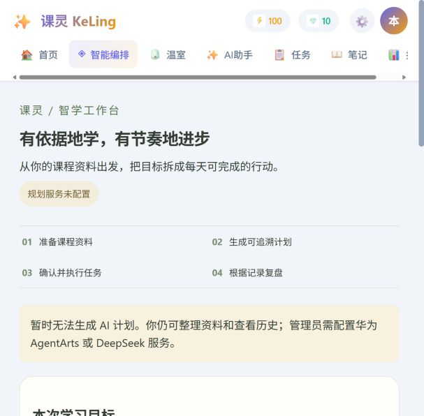

# 2026-10-28 本地验证记录

> 历史记录（2026 年 10 月）。保留当时版本、操作和验证结论；当前入口与运行方式见[文档索引](../../README.md)。

基线 `aa3693e738f58f082c421dc545048bf943d167f3`，分支 `codex/kotlin-reliability-upgrade`。结果来自 Windows 本地执行；没有把模拟提供方测试计为真实云端成功。

| 验证对象 | 结果 | 实际检验内容 |
| --- | --- | --- |
| 服务端 | 18 项测试通过，0 失败 | 资料归属与引用、计划日期/时长、SSE 分片与失败、后台事件、超时恢复、并发完成、事务回滚、HTTP 权限与登录限流、真实版本号 |
| Android | 22 项测试通过，0 失败 | 其中 21 项为数据/网络回归，1 项为原有示例；覆盖账户隔离、迁移、保存、接口格式、云端任务状态及版本检查 |
| Android 构建 | Debug APK 成功，v2 签名验证通过 | Kotlin/Compose 编译、资源处理与打包；未运行真机 UI |
| Android Lint | 0 错误，93 警告 | 仍有历史资源、兼容性和静态分析警告，不等于零告警发布版 |
| 网页与服务端构建 | `npm run check` 通过 | TypeScript、Vite 和 ESLint；ESLint 为 0 错误、55 警告 |
| npm 生产依赖审计 | 0 项已知漏洞 | `npm audit --omit=dev --audit-level=high`；仅表示本次审计数据库结果 |
| 全依赖审计 | 从 21 项降为 4 项低风险 | 剩余为 deepmerge / Rollup / Workbox / PWA 构建依赖链；未通过强制降级 PWA 插件规避报告 |

## 浏览器实测

使用本机开发数据库内明确命名的测试账户，验证登录、创建“数据结构（本地验证）”、保存“二叉树遍历”资料，以及跨页面后仍能读取该课程和 1 个知识点。未配置云端服务时，界面显示配置状态并禁用生成按钮。

实测发现并修复：小屏导航被隐藏、读取账户信息占用登录尝试限额、网络错误清除登录凭证，以及重复加载账户造成页面反复挂载。修复后可通过重试恢复账户，不必重新输入凭证。任务界面进入或重新获得焦点时刷新云端数据。

浏览器实际视口宽度是 615 CSS 像素，页面内容宽度为 607，无整页横向溢出；导航栏可独立横向滚动。请求的 390/1280 视口覆盖未在该内置浏览器生效，因此不将其写成手机/桌面全尺寸验收。截图是实际页面，未替换生成结果。

## APK 与复现

本地安装包：`releases/KeLing-ICT-3.1.0-preview-debug.apk`，版本 `3.1.0-preview` / `versionCode=9`，55,399,031 字节。

SHA-256：`2f33387e561cba3d7834578dc2a71c863dbd08b0d75c8e6a47b193c19f50db24`。

这是调试签名安装包，默认 API 为 Android 模拟器访问电脑的 `http://10.0.2.2:3001/api`；直接安装到真机后需重新构建为实际后端地址。正式发布需要自己的 HTTPS 服务、正式签名与真机验证。

完整启动和配置见 [多端升级文档](MULTIPLATFORM_UPGRADE.md)。机器可读记录见 [validation/2026-10-28.json](../../validation/2026-10-28.json)。本机原始日志在 `.cache/server-tests.log`、`.cache/web-server-check.log` 和 `.cache/android-check.log`；日志与数据库不提交到仓库。

## 未完成的外部验证

- 未配置真实 AgentArts 或 DeepSeek 凭据，尚无真实云端运行证据。
- 没有 Android/华为真机和模拟器 UI 操作证据；原生鸿蒙 NEXT 客户端尚未开发。
- PostgreSQL 并发、云部署、多实例后台运行恢复、完整双向同步仍需后续实现或验证。
- GitHub Actions 尚未运行本分支。本地通过不等于远端 CI 通过。

这些限制不会阻止本地课程资料与任务管理；会限制对云端规划效果、多端设备兼容性与生产可靠性的结论。
