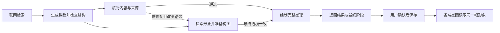

# 星图形象与真实生成阶段

当前公开版本：4.3.2-progress-rc1 / Android versionCode 34。业务源码为 `25c2be2f9231bb75b9aa345dcc9e7d41c5be3f9b`，下载适配元数据为 `a06cc09`。以下分开记录实现、发布、真实调用结果与已知限制。

## 问题与改动

旧网页星图和课程详情仍按学科选预置插画，学习星球详情则使用模型生成图；Android 普通课程卡片也未关联保存的学习星球记录。因此同一 `courseId` 在不同入口可能出现不同外观。

新版按 `courseId` 读取账号所属的星球，复用其 `draft.artwork.url`。网页确认或重绘后发送更新通知，切回窗口重新获取记录；Android 星球与课程入口读取同一保存记录。有效生成图加载失败只显示重试入口，未生成定制图的普通课程保留原插画。这不改变课程、题目或学习进度。

此前生成只有等候提示，用户无法知道后台处于哪个环节。本轮增加独立于签名草稿的进度记录：联网检索、课程编织、内容核对、视觉准备、绘图和封装。后台完成后才填充对应进度段；运行环节持续扫光，并轮换课灵探索短句。审核和视觉准备可能同时显示进行中。未执行的环节显示已跳过；没有服务端阶段信息的旧同步接口只显示不定动画。没有用时间估算模型内部百分比。

## 提速方式与取舍

1. 结构检查通过后，并行执行内容审核和视觉检索、设计、参考图准备；内容通过原审核门槛后才绘图。修复改变视觉依据时丢弃旧准备，按最终语境重新准备。
2. 精简审核副本的无关图像、生成元数据，以及单题范围里重复的来源副本。来源摘录、课文、答案和评分字段均保留，验证仍使用原始完整草稿。
3. 同一网页的候选参考图最多两个并发验证，仍按原顺序选择，不改公网地址、重定向、文件内容、大小和时间限制。

模型、图像分辨率、生成题量、审核覆盖和一次修复上限均未降低。并行的收益来自两个准备分支的重叠，不能由一次总耗时承诺固定加速比例。审核拒绝时可能已有未被采用的视觉设计请求；平台 SDK 不提供在途请求的真实取消能力，应用只能检查取消状态并丢弃迟到结果。原分析与候选方案见[耗时分析](topic-generation-latency-analysis-2026-11-28.md)，其中局部修题与相似题并行审核建议本轮没有实施。

## 已完成的确定性验证

| 对象 | 结果 | 能证明什么 |
| --- | --- | --- |
| 服务端隔离 SQLite | 183 / 183 | 阶段在实际 await 完成后推进；任务隔离、并行审核与准备、未通过不绘图、语义变更重算、保存后独立客户端读取 |
| Web | 99 / 99，构建通过，lint 0 错误 / 26 既有警告 | 协议校验、旧修订号拒绝、重绘刷新、游客和账号隔离 |
| Android | 142 / 142，构建通过，lint 0 错误 / 40 既有警告 | 阶段解析、取消及失败状态、课程对应形象 |
| 参考图并发合成延时 | 256.3ms → 124.1ms，峰值 2 | 仅该 120ms 固定延时夹具中的等待重叠；选图结果与顺序相同，不是模型全流程加速比例 |
| GitHub CI | 两项任务成功 | 源码在独立 Linux 构建环境通过当前工作流 |

[CI 运行](https://github.com/Hyhyhyyy/KeLing4.0/actions/runs/46152912154)；[Web 完整界面与复跑脚本](progress-web-2026-11-28/README.md)；[Android 包与只读原生画面](topic-android-progress-2026-11-28.md)。网页合成接口实测 1440×1000 和 390×844，动画持续而完成数不随时间增长，系统减少动效会停止装饰动画；模拟失败后恢复图片仍为同一 URL。Android 从真实账号读取已有奶龙球，星图、课程、详情均显示相同生成图。这些观察不能代替新版本真实生成测试。

## 安装包

文件：`keling-4.3.2-progress-rc1.apk`，85,236,835 字节。

- SHA-256：`e93e055ce99289e308079a84057284a170f6c5db280fee19d1bfba2f3a607549`
- 既有签名证书：`e7b4d86c7a02fb6bb1d21215c393b347d2d67652e5e45dfbe3a3d6c66b7c67a3`
- 华文中宋与授权源逐字节相同，72 项共享素材逐字节相同。
- 共享图谱仍为 `editor-5Z5EDZT7.js`，SHA-256 `31fac6b7230d7aaa55b6de18f74fa5e1b3fdee8a31674def476519d35b23c26c`。

## 正式发布与真实调用

妙搭正式发布 `7713232662001339416` 已为 FINISHED，模板提交 `5bb1d57204ad64e17e4a14e9326839105d623b49`。网页入口产物为 `index-B3jtI2AL.js`；既有[公开入口](https://ucn5aajxnx7f.feishuapp.com/app/app_17h4dw5jwdg)继续使用，未迁移数据库。

[GitHub 预发布](https://github.com/Hyhyhyyy/KeLing4.0/releases/tag/v4.3.2-progress-rc1)的 APK 大小与 GitHub 官方资产摘要均与本地一致；应用存储对象 `/1883111334116376.apk` 已完整回下载核对同一 SHA-256。首次存储上传网络失败，核查对象后一次正常重试成功，没有将失败操作记为上传成功。

两域健康、78 项生成文件、固定字体素材与两个公开 APK 下载入口的完整核验见[正式部署](progress-deployment-2026-11-28.md)。

首次真实网页测试正常填写“分数的意义与等值分数 / 初学者 / 小学五年级目标 / 6题 / 绘图”，只发送一次生成请求。客户端 158.066 秒后收到 `CONTENT_REVIEW_FAILED`，没有新草稿、图片、确认或保存。后台同钟记录检索 1.394 秒、内容组织 42.984 秒、审核及修订 110.947 秒；55 次初始/轮询响应观察到审核与视觉准备同时运行，修订后再次审核失败。实际加载界面始终只完成 2/6 环节，失败后停止活动并保留输入。完整记录见[Web 真实阶段](progress-web-production-2026-11-28/README.md)。

视觉准备阶段的标记结束时间还包含等待最终语境审核，不能将其与审核的时间交集直接当作节省秒数。这次调用证明阶段展示与失败处理运行真实，但未证明整颗星球成功生成或全流程变快。只读 SDK 日志进一步确认，7.480 秒的视觉规划发生在初稿审核期间；最终 q3 被报告为答案与解析冲突。日志也显示多选非评分占位字段干扰审核，以及推导型数学排序与现有直接引用证据规则的适配限制。最终草稿被日志截断，不能独立确认 q3 原文或断言不存在回归，详见[本次失败诊断](progress-review-diagnostic-2026-11-28.md)。未通过降低审核门槛来把失败改成成功。

之后在 Android 正常界面仅执行一次已有奶龙星球的重绘，成功取得 `miaoda-image/grounded-reference` 的 2048×2048 新图，服务端生成时间为 `2026-11-28T14:58:00.904Z`。主线程独立比较前后记录，14 道题、完整区域、知识图谱、教学来源与作答进度均相同，仅形象更新。Android 星图、课程与详情显示新图；Web 随后在四个入口独立读到同一个新 URL，URL 的 SHA-256 为 `983aa5a9aeca1b874c077d446a2664ef768d7d17dc930447ed577c7d56ef0628`。

手机保留真实请求启动和完成画面，中间分段状态未被连续截图捕获；不为补图再次调用模型，也不把观测上界当作精确推理耗时。真实分段事件由前述 Web 请求记录，手机协议和状态映射由自动测试验证。单次重绘成功与首次整球生成失败分别记录，不能拼成一次成功整球流程。

此前默认主题生成失败、模型来源表述与内容准确性问题仍见[前轮真实验证](topic-research-release-2026-11-28.md)，本轮不把进度展示当作这些问题已全部解决。答辩稿和 PPT 本轮未替换；原账号、实体设备与人工审题事项继续见[人工事项](manual-followups-2026-11-28.md)。
